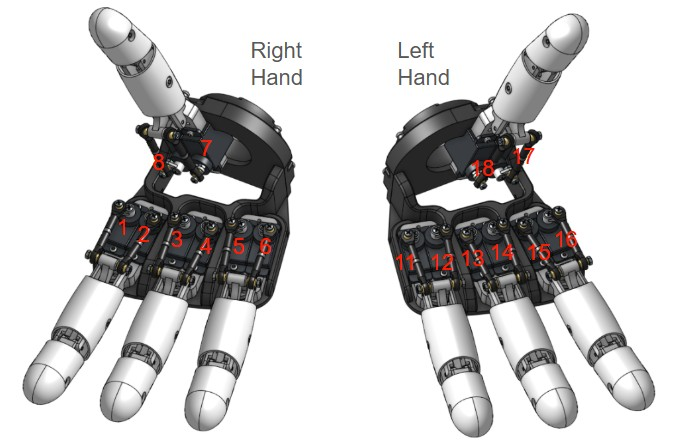

[Deutsch](../de/README.md) | [English](../en/README.md) | [Español](../es/README.md) | [Français](../fr/README.md) | [Italiano](../it/README.md) | [日本語](../ja/README.md) | 한국어 | [Português (Brasil)](../pt-br/README.md) | [Português (Portugal)](../pt-pt/README.md) | [简体中文](../zh-hans/README.md) | [繁體中文](../zh-hant/README.md)

# AmazingHand 웹 제어

브라우저에서 AmazingHand dexterous hand를 제어합니다 — **왼손 또는 오른손**, 조작 방식은 두 가지입니다:

- **Manual** — 서보 슬라이더 8개 + 프리셋 포즈 19개 + 클릭 한 번으로 중간 위치 복귀
- **Camera teleop** — MediaPipe가 브라우저에서 로컬로 실행되며 손을 손가락에 실시간으로 매핑합니다 (영상은 컴퓨터 밖으로 나가지 않음)
- **이중 언어 UI** — 오른쪽 상단에서 중국어와 영어를 전환하며, 선택은 브라우저에 저장됩니다

서보 매핑, 포즈 라이브러리, 변환 공식은 모두
[AmazingHandControl](https://github.com/pollen-robotics/AmazingHand)(공식 GUI)과 일치합니다.

---

## 빠른 시작

```bash
pip install -r requirements.txt

python server.py --no-connect   # 권장: 서버만 먼저 띄우고 포트는 페이지에서 선택 (로봇 손은 움직이지 않음)

# python server.py                # 시리얼 포트를 자동 감지하고 연결
# python server.py --port COM9    # 특정 포트 지정
# python server.py --hand left    # 왼손만 활성화
# python server.py --dry-run      # 시리얼 포트를 전혀 열지 않고 UI만
```

그다음 브라우저에서 **http://localhost:8000** 을 엽니다.

### 페이지에서 시리얼 포트 선택

페이지 상단에 포트 바가 있습니다:

```
Port  [COM3 ★ USB-Enhanced-SERIAL CH343 ▾]  [Refresh]  [Connect]  [Disconnect]  Connected to COM3
```

- 드롭다운에 이 컴퓨터의 모든 시리얼 포트가 나열됩니다. 흔한 USB-시리얼 칩(CH34x / CP210x / FTDI …)은 **★** 표시가 붙고 맨 앞에 정렬됩니다
- **Refresh**는 다시 스캔합니다(보드를 꽂은 뒤 사용하세요)
- **Connect**는 선택한 포트를 엽니다. 연결되면 곧바로 로봇 손이 중간 위치로 복귀합니다
- **Disconnect**는 먼저 토크를 해제하므로 서보가 있던 자리에 그대로 고정되지 않습니다
- 포트를 바꾸려면 새 포트를 고르고 Connect를 누르면 됩니다 — 이전 포트는 자동으로 닫힙니다

> **`--no-connect`는 바로 이 흐름을 위한 옵션입니다**: 시리얼 포트를 전혀 건드리지 않고 서버를 시작하므로,
> 엉뚱한 포트를 잡아 로봇 손을 튕기게 할 일이 없습니다. 시작할 때 바로 연결되게 하려면 이 플래그를 빼세요.

시리얼 로그는 `server.log`에 기록됩니다(`.bat`으로 실행하면 창이 순식간에 지나가므로, 창 대신 파일을 보세요).

### 배선 점검

찾은 서보 ID를 나열하고, 손별로 `config.json`과 대조해 확인합니다.

```bash
python tools/scan_servos.py --port COM9
```

COM9를 실제 사용하는 포트로 바꾸세요.

---

## 서보 매핑

출처: `AmazingHandControl/hand_logic.py`의 `DEFAULT_HAND_SERVOS` 및
`docs/zh-hans/CONFIG_FORMAT.md`.

| 손가락 | 오른손 ID | 왼손 ID |
|---|---|---|
| 약지 | 5, 6 | 11, 12 |
| 중지 | 3, 4 | 13, 14 |
| 검지 | 1, 2 | 15, 16 |
| 엄지 | 7, 8 | 17, 18 |

### 손가락 하나의 두 서보는 역할이 다릅니다 ⚠️

공식 규칙:

```
servo1 (홀수 ID)  = 굴곡 축   열림 ↔ 닫힘
servo2 (짝수 ID) = 벌림 축   손가락 모음 ↔ 벌림
```

UI에는 정확히 이 두 축이 표시됩니다. **"손가락이 벌어지지 않음 / 오므라들지 않음"은 벌림 축이 움직이지 않는다는 뜻입니다** —
가위 모양 V는 검지 벌림 `+17`과 중지 벌림 `−30`에서 나옵니다(하나는 양수, 하나는 음수).

전송할 때 두 값이 합쳐집니다(공식 저장 형식과 동일):

```
servo1 = 굴곡 + 벌림
servo2 = 굴곡 − 벌림
```

범위(공식 포즈 19개 + 중간 위치로부터 도출):

| 축 | 범위 | 의미 |
|---|---|---|
| 굴곡 | −50 ~ +90 | 열림(음수) ↔ 닫힘(양수) |
| 벌림 | −45 ~ +45 | 모음(음수) ↔ 벌어짐(양수) |

**ID 규칙 두 가지**(틀리면 서보가 타거나 동작이 반대로 바뀝니다):

1. **홀수 ID는 각 손가락의 첫 번째 서보, 짝수 ID는 두 번째입니다.** 양손 모두 성립합니다
   (왼손 11/12, 13/14 … 도 홀짝이 번갈아 나옵니다). 두 번째 서보는 **거꾸로 장착**되어 있으므로 변환할 때 부호를 반대로 합니다.
2. **왼손은 9–16이 아니라 11–18이고, 약지부터 번호가 매겨집니다.** 1–8로 순서대로 배선하면 항상 틀립니다.



---

## 변환

`AmazingHandControl`의 `apply_pose()`와 동일합니다(포즈별로 검증 완료):

```
1) mirror_pose가 true이면, 먼저 각 손가락의 서보 두 값을 교환
2) servo_deg = (ID 홀수 ? +1 : -1) × (포즈 값 − angle_offset_deg)
```

| 손 | angle_offset_deg | mirror_pose |
|---|---|---|
| 오른손 | `0` | **예** ⚠️ |
| 왼손 | `-35.16` | 예 |

`-35.16°`는 오른손 대비 왼손 서보 혼이 어긋난 물리적 반 슬롯 오프셋으로, 공식 설정에서 가져온 값입니다.

> **`mirror_pose`에 대해 — 이 빌드는 공식 빌드와 다릅니다**
>
> 공식 레퍼런스에서는 왼손만 `true`입니다. **이 빌드의 오른손 모듈은 서보 쌍도 거꾸로 장착**되어 있어서
> 오른손도 `true`입니다.
>
> 이 교환은 **벌림만** 뒤집고 굴곡은 건드리지 않습니다: `base = (a+b)/2`는 교환해도 변하지 않지만
> `side = (a−b)/2`는 부호가 바뀝니다. 따라서 어느 한 손의 벌림이 뒤집혀 나오면, 가장 먼저 확인할 스위치가 이것입니다.

포즈 배열은 항상 **`[ring, middle, index, thumb]`** 순서의 8개 값이고, 손가락마다 2개입니다 —
공식 `data/hand_config.yaml`과 바이트 단위로 동일하므로 곧바로 대조할 수 있습니다.

### 계산 예시

| 포즈 | 오른손 | 왼손 |
|---|---|---|
| `open` `[-35]*8` | ID5 **−35** / ID6 **+35** | ID11 **+0.16** / ID12 **−0.16** |
| `close` `[75]*8` | ID5 **+75** / ID6 **−75** | ID11 **+110.16** / ID12 **−110.16** |
| 중간 `[-17.578]*8` | ID5 **−17.58** / ID6 **+17.58** | ID11 **+17.58** / ID12 **−17.58** |

> **왼손의 `close`는 ±110.16°가 필요하며**, 오른손보다 훨씬 큽니다. 그래서 `config.json`의
> 제한을 **±120°**로 두었습니다(SCS0009의 전체 범위는 약 ±150°). ±90으로 제한하면 왼손의 주먹이 잘립니다.

---

## 프리셋 포즈 (19개)

| 포즈 | | 포즈 | |
|---|---|---|---|
| `open` | 열기 | `wave1` | 손 흔들기 |
| `close` / `stone` | 주먹 | `wave_r` / `wave_l` | 오른쪽 / 왼쪽 스와이프 |
| `ok` | OK | `ring_close` | 약지만 |
| `greeting` | 인사 | `middle_close` | 중지만 |
| `victory` / `two` / `scissors` | 브이 / 둘 | `pointer_close` | 검지만 |
| `paper` | 보 | `thumb_close` | 엄지만 |
| `one` / `three` | 하나 / 셋 | `hifive` | 하이파이브 |

포즈를 바꾸려면 `config.json`의 `poses` 섹션을 편집하세요. 키 이름은 공식 YAML의 이름과 일치합니다.

### 왼손과 오른손에 다른 값을 쓸 수 있습니다

포즈 안에서 `positions`는 **양손이 공유**합니다. 기계 조립 차이 때문에 한쪽 손에 다른 값이 필요하면,
해당 항목에 `right` 또는 `left` 키를 추가하면 `positions`를 덮어씁니다:

```jsonc
"close": {
  "label": "Fist",
  "positions": [75, 75, 75, 75, 75, 75, 18, 18],   // 양손 공용
  "right":     [ ... 8개 값 ... ]                   // 선택 사항: 오른손 전용
}
```

`right` / `left` 키가 없는 포즈는 양손 모두 공유 값을 사용합니다 — 따라서 실제로 다른 것만 작성하면 됩니다.
중간 위치(`middle`)는 여전히 양손이 공유합니다.

---

## 두 가지 모드

| 모드 | 동작 |
|---|---|
| **오른손** | 오른손의 서보 8개에만 전송 |
| **왼손** | 왼손의 서보 8개에만 전송(미러 + −35.16° 오프셋 자동 적용) |

한 번에 한 손만 제어합니다. 양손 모두 같은 버스에 연결되어 있으며, 상단의 **Target**으로 전환합니다.
전환해도 다른 손은 건드리지 않습니다 — 그 손은 있던 포즈를 그대로 유지합니다.

---

## 카메라 텔레오퍼레이션

MediaPipe 손 랜드마크가 브라우저에서 로컬로 실행됩니다(에셋은 `web/mediapipe/` 아래에 있으며 오프라인에서도 동작).
21개 랜드마크를 손가락 4개의 포즈 값으로 변환해 선택된 손으로 전송합니다.

### 1. 먼저 세 가지 포즈를 캡처합니다

카메라를 시작한 뒤 손을 취하고 해당 포즈의 캡처 버튼을 클릭합니다(약 1초간 평균).
순서는 상관없고, 같은 버튼을 다시 누르면 재캡처됩니다. **세 개가 모두 들어와야 상태가 초록색으로 바뀝니다** —
그 전까지는 아무것도 전송되지 않아 로봇 손은 중간 위치에 머뭅니다.

| 버튼 | 포즈 | 제공하는 것 |
|---|---|---|
| ① Spread | 손가락을 곧게 펴고 벌린 상태, 엄지는 바깥쪽을 향함 | 굴곡의 "곧게 편" 끝 + 벌림의 "벌어진" 끝 |
| ② Together | 손가락을 곧게 펴고 모은 상태, 엄지는 검지에 붙임 | 벌림의 "모음" 끝 |
| ③ Fist | 주먹을 쥐고 엄지는 손바닥 쪽으로 접음 | 굴곡의 "닫힌" 끝 |

### 2. 각 축은 측정한 두 점을 지나는 직선입니다

굴곡과 벌림 모두 **측정한 두 엔드포인트로 직선을 정의**합니다:

```
t      = (측정값 − 엔드포인트A) / (엔드포인트B − 엔드포인트A)      // 0..1로 클램프
목표값 = A.목표값 + (B.목표값 − A.목표값) × t
```

장점은 **각 손가락 측정값의 부호가 자동으로 흡수된다**는 점입니다 — 따라서 "이 손가락을 반대로" 같은
체크박스를 체크할 필요가 없습니다. (검지와 약지는 중심선의 반대쪽에 있고 엄지는 관절 체인이 달라
방향이 실제로 반대인데, 측정 엔드포인트 두 개가 이를 흡수합니다.)

엔드포인트 목표값은 `config.json`의 `camera` 섹션에 있습니다:

| 축 | 엔드포인트 | 약지 | 중지 | 검지 |
|---|---|---|---|---|
| 굴곡 | 곧게 폄 → 주먹 | −50 → 90 | −50 → 90 | −50 → 90 |
| 벌림 | 모음 → 벌림 | −45 → +45 | 0 → 0 | +45 → −45 |

중지의 벌림 양 끝은 모두 0입니다(중지는 옆으로 움직이지 않습니다).

> **이 두 세트는 양손이 공유합니다.** 어느 한 손이 반대로 움직이면 `camera.side_sign`에서 그
> 손을 바꾸고(문서 끝의 튜닝 치트시트 참고) 페이지를 새로 고치세요.

### 3. 엄지는 굴곡만 합니다 ⚠️

엄지의 CMC는 **안장형(대립) 관절**이고, 굴곡이 외전과 강하게 결합되어 있습니다 —
엄지를 검지에 붙인 상태는 이미 벌림 위치에 있으므로, 그때 측정한 "굴곡 영점"은 오염되어 있습니다.
억지로 두 축으로 나누면 둘 다 틀어집니다.

그래서 엄지는 **굴곡만 하고 벌림은 항상 0**입니다(두 서보가 같은 값을 받습니다). 필요한 참조 포즈는
①(바깥쪽을 가리킴)과 ③(손바닥 쪽을 가리킴) 둘이며, 추가로 캡처할 것은 없습니다.

### 4. 손가락이 굽어질수록 벌림이 사라집니다

최종 벌림은 다음으로 스케일됩니다:

```
side = side_measured × (1 − curl)
```

`splayDeg`는 MCP→PIP 방향을 손바닥의 가로 축에 투영한 값인데, 손가락 굴곡은 **바로 그 축을 중심으로 회전**합니다 —
일정 굽힘을 넘으면 투영의 부호가 뒤집혀 측정된 "벌어짐"이 갑자기 반대쪽 끝으로 튑니다.

이 감쇠가 없으면 그 튐이 `servo2 = flexion − splay`를 타고 **짝수 ID 서보**를 역방향으로 끌고 갑니다.
(홀수 ID는 `flexion + splay`를 받아 같은 방향으로, 다만 더 빠르게 움직이므로 눈에 띄지 않습니다.)
증상은 "주먹을 절반쯤 쥐었을 때 서보 12와 16이 갑자기 반대로 돈다"입니다 — 12는 왼손 약지의 벌림 서보,
16은 왼손 검지의 벌림 서보로, 정확히 벌림 목표값이 0이 아닌 두 개입니다.

감쇠가 있으면 측정값이 아무리 엉망이어도 완전히 쥐었을 때 벌림은 **정확히 0**입니다.
애초에 주먹은 손가락을 모은 상태여야 하니까요.

### 5. 스켈레톤 색상

| 손가락 | 색상 |
|---|---|
| 엄지 | 주황 |
| 검지 | 빨강 |
| 중지 | 파랑 |
| 약지 | 노랑 |
| 새끼손가락 | 어두운 회색 |
| 손바닥 뼈 | 중립 회색 |

새끼손가락은 제스처 매핑에 쓰이지 않지만, **밑동 MCP(17번 랜드마크)가 오른손 손바닥 좌표계를 정의**하므로
그냥 빼버릴 수 없습니다. 모델은 21개 점을 한 번에 회귀하며 "이 손가락은 보이지 않음" 같은 상태가 없어서,
손바닥에 가려져도 **추정한** 위치를 반환합니다. 어둡게 그리면 언제 추정 중인지 한눈에 알 수 있습니다.

### 튜닝 치트시트

| 바꾸고 싶은 것 | 어디서 |
|---|---|
| 각 축 목표값 | `config.json`의 `camera` 섹션 |
| **좌우 벌림 방향이 서로 반대** | `camera.side_sign`에서 해당 손을 `-1`로 (`1` = 그대로) |
| 부드러움 | `tracking.js`의 `SMOOTH` (기본 0.35; 낮을수록 안정적이지만 반응이 느림) |
| 굽힘 인식 속도 | 세 가지 포즈를 다시 캡처 |

`side_sign`은 **Target**에서 선택한 손에 적용됩니다. 값을 바꾸고 페이지를 새로 고치면 되며,
서버 재시작은 필요 없습니다:

```jsonc
"side_sign": { "right": 1, "left": -1 }   // 왼손의 벌림 축 전체를 반전
```

굴곡은 `side_sign`의 영향을 받지 않습니다.

---

## 프로젝트 구조

```
Amazinghand-web/
├── config.json          서보 매핑 / 포즈 라이브러리 / 시퀀스 / 제한 (공식 YAML에서 생성)
├── server.py            백엔드: 시리얼 + 정적 파일 + WebSocket
├── requirements.txt
├── README.md            영어
├── tutorials/           de · en · es · fr · it · ja · ko · pt-br · pt-pt · zh-hans · zh-hant
├── tools/
│   └── scan_servos.py   버스에서 서보를 스캔하고 ID를 확인
└── web/
    ├── index.html · app.js · tracking.js · style.css
    ├── i18n.js          UI 문자열 (중국어/영어 사전 + 오른쪽 상단 전환)
    └── mediapipe/       MediaPipe 에셋 (로컬 번들, 오프라인, 약 42MB)
```

프런트엔드/백엔드 프로토콜:

```jsonc
// 프런트엔드 → 백엔드   target: "left" | "right"
{ "cmd": "ports" }                                  // 시리얼 포트 다시 스캔
{ "cmd": "connect",    "port": "COM3" }
{ "cmd": "disconnect" }
{ "cmd": "target", "target": "left" }
{ "cmd": "set",    "target": "left", "angles": { "pointer": [0, 0], ... } }
{ "cmd": "pose",   "target": "left", "name": "close" }
{ "cmd": "middle", "target": "left" }
{ "cmd": "torque", "target": "left", "on": true }
{ "cmd": "stop" }

// 백엔드 → 프런트엔드
{ "type": "state", "hands": {...}, "poses": {...}, "positions": {...},
  "axes": {...}, "camera": {...}, "target": "left",
  "limits": {...}, "port": { "available": [...], "current": "COM3", "connected": true } }
{ "type": "ports" | "connected" | "disconnected", "ports": [...], ... }
{ "type": "error", "msg": "connect COM_FAKE failed: the system cannot find the file specified." }
```

---

## 안전

| 항목 | |
|---|---|
| **포즈 제한** | ±120° (`config.json`의 `limits`), 19개 포즈 모두 범위 안에 있는지 확인함 |
| **변화 중복 제거** | 0.5° 미만 변화는 전송하지 않아 버스가 노이즈로 넘치지 않음 |
| **쓰기 스로틀** | 쓰기 간 최소 20 ms |
| **E-stop** | UI의 빨간 버튼을 누르면 모든 서보 토크가 한 번에 해제됨 |
| **종료 보호** | Ctrl+C 시 토크가 자동으로 해제됨 |
| **한 손 디버그** | `--hand left/right` |

---

## 문제 해결

**동작이 반대로 나옴** → 배선이 "홀수 ID가 먼저" 규칙을 따르는지 확인하세요. 왼손은 `angle_offset_deg = -35.16`도 확인하세요.

**왼손 주먹이 너무 작음 / 서보에서 소음이 남** → 제한이 아직 ±90일 가능성이 큽니다. `config.json`에 ±120이 들어 있는지 확인하세요.

**손가락이 움직이지 않음 / "모터 N개가 필요한데 M개 발견됨"** → `tools/scan_servos.py`를 실행하세요. 왼손 ID가 가장 배선을 틀리기 쉽습니다.

**중간 위치가 어긋남** → 중간 값 `-17.578125`는 공식 raw 451/571에서 변환한 값입니다.
자신의 조립 상태에 맞춰 보정하려면 `config.json`의 `middle.positions`를 편집하세요.

**카메라 추적이 떨림** → 조명을 고르게 하고 손바닥을 카메라 쪽으로 향하게 하세요. `tracking.js`의
`SMOOTH`(기본 0.35) — 높을수록 부드럽지만 반응이 느립니다.

**카메라 제스처가 틀림 / 손가락이 따라오지 않음** → 위의 카메라 텔레오퍼레이션 섹션을 보세요. 먼저 세 가지를 확인하세요:

1. **세 가지 포즈가 모두 캡처되었나요?** — 상태가 초록색이어야 합니다. 그 전에는 아무것도 전송되지 않고 로봇 손은 중간 위치에 머뭅니다
2. **방향이 반대면 그 포즈를 거꾸로 캡처한 것입니다** — 해당 버튼 하나만 다시 캡처하면 되고, 코드 수정은 필요 없습니다
3. **엄지는 벌어지면 안 됩니다** — 굴곡만 하며, 위 3번 섹션을 보세요

**주먹을 절반쯤 쥐었을 때 서보가 역방향으로 튐** → 그 서보는 **짝수 ID**(벌림 축, 예: 왼손 12 / 16)여야 합니다.
원래는 벌림이 굽힘에 따라 0으로 감쇠하며 튀지 않습니다. 이런 현상이 보이면
`tracking.js`의 `side *= (1 - curl)` 줄이 적용되지 않았거나 `curl`이 계산되지 않는 것입니다.
