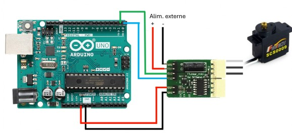
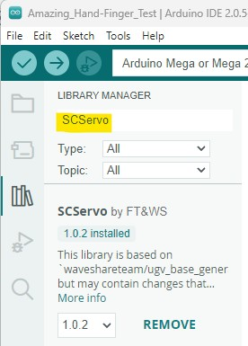
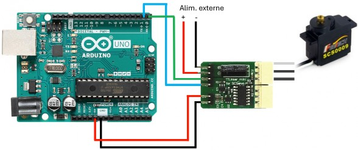
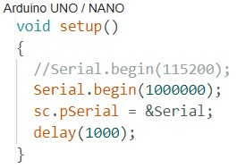
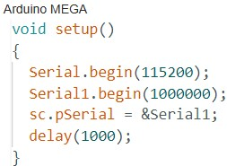

# Arduino- und Python-Beispiele

Diese Seite fasst die offiziellen Beispiele und Verkabelungshinweise aus `AmazingHand-main/ArduinoExample/` und `AmazingHand-main/PythonExample/` zusammen.

## Arduino-Beispiele

### Vorbereitung

- In der Bibliotheksverwaltung der Arduino IDE die **SCServo**-Bibliothek installieren.
- Servo-IDs mit dem Feetech-FD-Debugging-Werkzeug setzen (`feetech debug tool`).
- Zwischen Arduino und TTL Linker **RX/TX gekreuzt verbinden**.

### Link-Modus: Servo-ID ändern

1. Zuerst das `Blink`-Beispiel auf den Arduino hochladen.
2. Nach Link-Modus verkabeln, Feetech-Software öffnen und die ID ändern.

### Control-Modus: Arduino steuert Servos

Nach dem Hochladen eines eigenen Programms nach Control-Modus verkabeln:

- **Arduino Uno** (nur ein serieller Port): laut Bild Software-Seriell/festgelegte Pins verwenden.
- **Arduino Mega**: **RX1 / TX1 (19 / 18)** verwenden.

> Pin-Nummern, Bibliotheksversion und TTL-Linker-Richtung maßgeblich nach Aufdruck der tatsächlichen Platine; vor der ID-Änderung Busstromversorgung und gemeinsame Masse prüfen.

## Python-Beispiele

`AmazingHand-main/PythonExample/` bietet 4 Basisskripte:

| Skript | Funktion |
|------|------|
| `AmazingHand_Demo.py` | Basis-Demo einer Hand: Bus verbinden, Aktionen ausführen |
| `AmazingHand_Demo_Both.py` | Zwei-Hand-Demo |
| `AmazingHand_FingerTest.py` | Einzelfingertest |
| `AmazingHand_Hand_FingerMiddlePos.py` | Kalibrierung der Fingermittelstellung |

Vor der Nutzung:

1. Servo-IDs mit der Feetech-Software setzen (rechts 1–8, links 11–18).
2. `pyserial` installieren, seriellen Namen/Baudrate im Skript anpassen und ausführen.
3. Bestätigen, dass die externe Servo-Stromversorgung angeschlossen ist und gemeinsame Masse mit der Bus-Treiberplatine hat.

> Dies sind die offiziellen Basisbeispiele; die vollständigere GUI/CLI siehe [SCS0009-Desktop-GUI](../04-desktop/scs0009.md), TTL-Verkabelung und Mittelstellung siehe [SCS0009-Servo-Debugging und Kalibrierung](../06-servo-tuning/scs0009.md).

## Quellcode-Position

- [`AmazingHand-main/ArduinoExample/`](../../../AmazingHand-main/ArduinoExample/)
- [`AmazingHand-main/PythonExample/`](../../../AmazingHand-main/PythonExample/)
