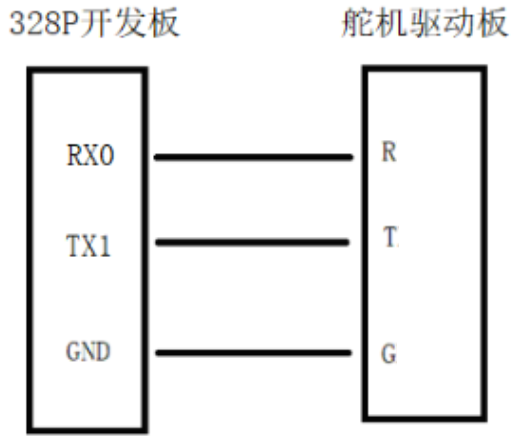
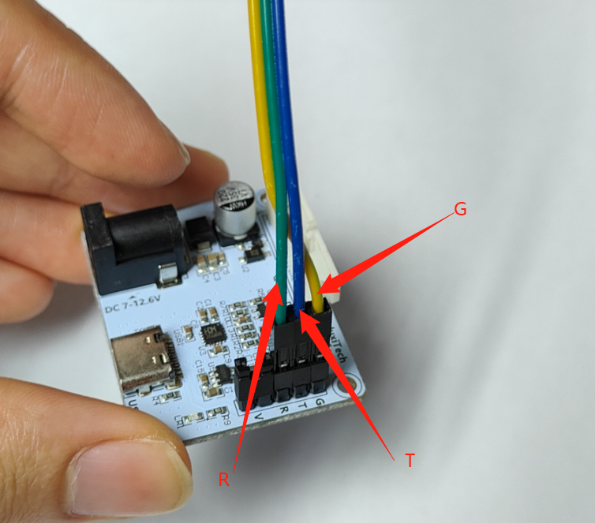
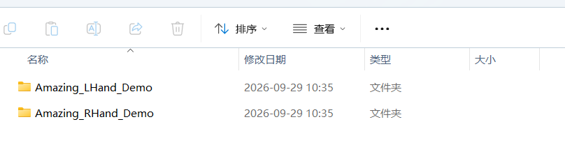
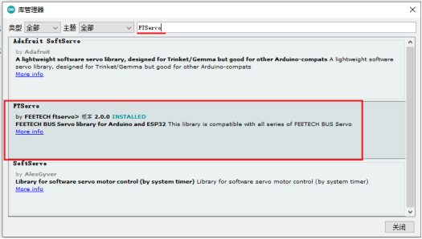

# Arduino Nano Tutorial

> This page is the Arduino Nano demo for the **SCS0009 bus servo version**. For TTL wiring and ID setup, see [SCS0009 servo debugging and calibration](../06-servo-tuning/scs0009.md); for more examples, see [Arduino / Python examples](examples.md).

## Wiring (servo driver board + Nano board)

**Check the pin positions on the Nano board (i.e. the 328P dev board) carefully!**

The process below uses an MCU. The MCU keeps looping the demo program, so just disconnect the data cable to stop it.

## Running the "02 演示程序"

1. Install the Arduino IDE yourself.

2. Open the corresponding `.ino` file for the **left or right hand**.

   

3. Before compiling and uploading the Arduino program to the Nano board, first install the **FTServo library** and the **SCServo library** in the "Library Manager".

   

4. Select the Nano board type "**Arduino Nano**".

   

5. Compile and upload.

> **Note:** at this point the computer is connected only to the Nano board, and the Nano board is not yet connected to the servo driver board (i.e. not connected to the dexterous hand).

After a successful upload, connect the Nano board to the servo driver board with three jumper wires, and connect the servos to the servo driver board; refer to [MEGA328P Nano board debugging wiring](https://juxitech.feishu.cn/wiki/Wt46wtt26imdWkkQlxTcL87qnHd#share-HdS4dNgwyo2seVxRZ9PcZ1R3nuc).

The dexterous hand will keep looping the "02 演示程序"; the result looks like this:

