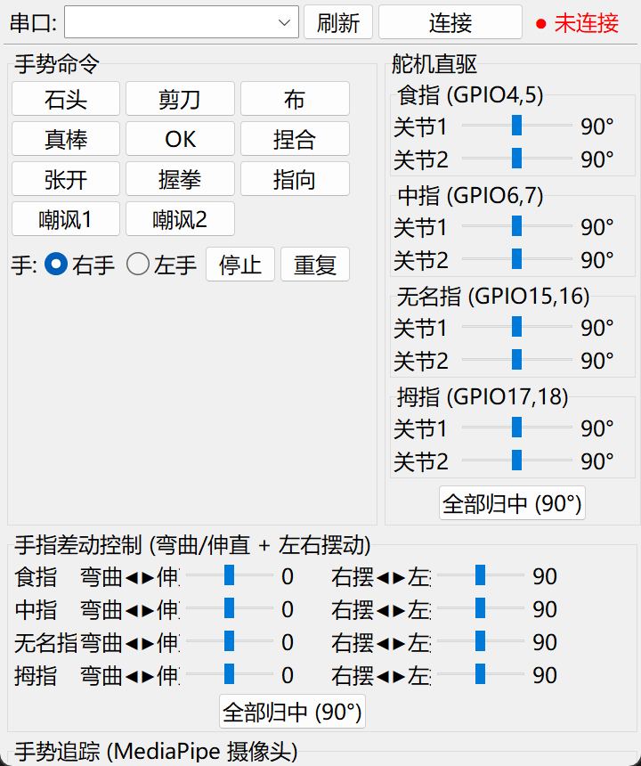
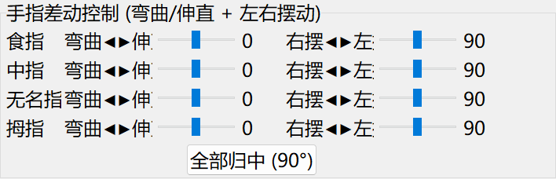

# Aplicación de escritorio PWM (GUI Tkinter)

> Los siguientes comandos se ejecutan en el directorio `AmazingHand-PWM/` del repositorio.

Esta página es el tutorial de control de escritorio de la **versión con servos PWM**. Para el control web, consulta [Control web PWM](../03-web-control/pwm.md); para el cableado, [Cableado PWM](../01-hardware/pwm.md); para el flasheo del firmware, [Inicio rápido PWM](../02-quick-start/pwm.md).

> Aplicable a: ESP32-S3 + 8 servos PWM (accionamiento diferencial). Flasheo del firmware: [Inicio rápido PWM](../02-quick-start/pwm.md); protocolo y comandos: [Protocolo y calibración PWM](../06-servo-tuning/pwm.md).

## 1. Modos de ejecución

| Modo | Requisitos | Recomendado para |
|------|------|------|
| **Ejecución desde el código fuente** (recomendado) | Python 3.12 de 64 bits + pyserial | Todas las funciones, incluido el seguimiento de manos |
| Empaquetar un exe propio | PyInstaller | Distribución sin instalar Python (ver sección 7) |

## 2. Ejecución desde el código fuente

### Instalar dependencias

En la raíz del módulo (`AmazingHand-PWM/`) ejecuta:

```bash
# dependencias básicas (pyserial)
pip install -r tools/requirements.txt

# ejecutar de nuevo solo si necesitas seguimiento de manos (crea automáticamente tools/tracking_env e instala mediapipe)
tools/setup_tracking.bat
```

> mediapipe 0.10.14 solo ofrece wheel para Windows de 64 bits, así que debes usar **Python 3.12 de 64 bits**.

### Iniciar la GUI

```bash
# cualquier Python con pyserial
python tools/hand_gui.py

# o usa el entorno de seguimiento (con mediapipe)
tools/tracking_env/Scripts/python tools/hand_gui.py
```



### Uso de la GUI

1. **Seleccionar el puerto serie**: elige el puerto COM del ESP32 en el desplegable superior (consúltalo en el Administrador de dispositivos).
2. **Pulsa «Conectar»**: la luz de estado se pone verde, el registro muestra «Conectado» y se envía automáticamente un NOP como prueba de enlace.
3. **Comandos de gestos**: pulsa «Piedra / Tijera / Papel / Pulgar arriba / OK / Pellizcar / Señalar / Abrir / Puño» y la mano ejecuta el gesto.
4. **Mano izquierda/derecha**: marca «Derecha» / «Izquierda» para cambiar (la dirección del espejo del pulgar es distinta).
5. **Control directo de servos**: arrastra los 8 deslizadores para controlar en tiempo real el ángulo de cada servo (0–180°).
6. **Control diferencial de dedos**: cada dedo tiene dos barras de progreso:
   - **Flexión ◀▶ Extensión**: flexiona o extiende el dedo (rango -70 ~ +70).
   - **Balanceo derecha ◀▶ izquierda**: desplaza el dedo a izquierda o derecha (rango 60 ~ 120, 90 = neutro).

   > Estas dos barras de progreso son **ejes de control**, no dos servos. El programa las combina en los ángulos de los dos servos de ese dedo: la componente en el mismo sentido produce splay y la componente en sentidos opuestos produce flexión.

7. **Repetir / Detener**: repite el último gesto / lo interrumpe inmediatamente.
8. **Registro de comunicación**: en la parte inferior se muestran en tiempo real las tramas enviadas/recibidas y las respuestas.



### Seguimiento de manos integrado en la GUI

La GUI incluye un panel de seguimiento de manos (la cámara sigue los movimientos de la mano):

1. Tras conectar el puerto serie, desplázate hasta el panel «Seguimiento de manos (cámara MediaPipe)».
2. Elige el número de cámara (0 por defecto) y pulsa **«Iniciar seguimiento»**.
3. Pon la mano en el campo de visión de la cámara y la mano seguirá la flexión/extensión.

> El seguimiento requiere haber instalado mediapipe con `tools/setup_tracking.bat`; solo la GUI iniciada desde el código fuente tiene función de seguimiento.

## 3. Prueba por línea de comandos (tools/serial_test.py)

Ejecuta en la raíz del módulo:

```bash
# prueba de enlace (confirma primero que hay comunicación)
python tools/serial_test.py COM3 nop

# gestos
python tools/serial_test.py COM3 rock         # piedra
python tools/serial_test.py COM3 thumbs_up    # pulgar arriba
python tools/serial_test.py COM3 index        # señalar
python tools/serial_test.py COM3 open         # abrir
python tools/serial_test.py COM3 close        # puño

# control directo de un servo
python tools/serial_test.py COM3 servo 1 90   # servo 1 → 90°

# centrar todo
python tools/serial_test.py COM3 mid

# configurar mano izquierda/derecha
python tools/serial_test.py COM3 hand L
python tools/serial_test.py COM3 hand R

# barrido/autotest
python tools/serial_test.py COM3 sweep 1      # barrido del servo 1
python tools/serial_test.py COM3 test         # prueba de todos los servos uno a uno
```

## 4. Prueba manual con herramienta de puerto serie (opcional)

Sin la aplicación de escritorio, también puedes verificar el enlace enviando tramas hexadecimales directamente con una herramienta de puerto serie.

**CoolTerm** (Windows / macOS / Linux):

1. `Options` → velocidad en baudios **115200**, 8N1.
2. `Connection` → `Send String` → selecciona `Hex`.
3. Envía `AA 01 00 01` (piedra); en la zona de respuesta deberían aparecer `BB 01 00 01` (ACK) y `BB 01 10 11` (completado).

**Línea de comandos Linux / macOS**:

```bash
# Linux
stty -F /dev/ttyUSB0 115200
printf '\xAA\x01\x00\x01' > /dev/ttyUSB0

# macOS
stty -f /dev/cu.usbserial-0001 115200
printf '\xAA\x01\x00\x01' > /dev/cu.usbserial-0001
```

El formato de trama, la suma de verificación y todos los comandos están en [Protocolo y calibración PWM](../06-servo-tuning/pwm.md).

## 5. Script de control en Python (desarrollo personalizado)

```python
import time
import serial

PORT, BAUD = "COM3", 115200          # en Linux/macOS cámbialo por /dev/ttyUSB0, /dev/cu.usbserial-*

def frame(cmd, data=b""):
    checksum = cmd ^ len(data)
    for byte in data:
        checksum ^= byte
    return bytes([0xAA, cmd, len(data)]) + data + bytes([checksum & 0xFF])

ser = serial.Serial(PORT, BAUD, timeout=1)
time.sleep(1)                        # espera a que el ESP32 termine de reiniciarse

ser.write(frame(0x00))               # prueba de enlace NOP
ser.write(frame(0x01))               # piedra
time.sleep(0.5)
ser.write(frame(0xF0, bytes([90] * 8)))  # los 8 servos a 90°
ser.close()
```

La trama de respuesta es `BB CMD STATUS CKSUM`; `STATUS=0x00` indica aceptado y `0x10` indica gesto completado. La tabla completa de comandos y los ejemplos de control directo/mano izquierda-derecha están en [Protocolo y calibración PWM](../06-servo-tuning/pwm.md).

## 6. Preguntas frecuentes

| Síntoma | Solución |
|------|------|
| Los servos no se mueven | Comprueba la alimentación (fuente independiente de 5 V 3 A), el puerto COM y el cableado |
| Sin respuesta / los servos se mueven solos al abrir el puerto serie | Confirma que la velocidad es 115200; la GUI envía primero un handshake NOP al conectar |
| La cámara no muestra imagen | Concede permiso de cámara (Configuración → Privacidad → Cámara) |
| La forma de la mano sale invertida | Marca la mano izquierda/derecha contraria |
| El seguimiento no responde | Confirma que inicias con el Python de `tools\tracking_env` y que mediapipe se instaló correctamente |

## 7. Empaquetar un exe propio (opcional)

```bash
pip install pyinstaller
python -m PyInstaller --onefile --noconsole --name "AmazingHand控制台" tools/hand_gui.py
```

La versión empaquetada no incluye el seguimiento de manos (los recursos de mediapipe son grandes); si necesitas seguimiento, usa la ejecución desde el código fuente.

> La descripción completa del protocolo y los comandos está en [Protocolo y calibración PWM](../06-servo-tuning/pwm.md).
