# Suivi de main SCS0009 (démo dora officielle)

Cette page présente la chaîne officielle de suivi de main de la **version à servos à bus SCS0009** : caméra → MediaPipe → IK MuJoCo → AHControl (Rust) → SCS0009. Pour le suivi de la version PWM, voir [Suivi de main PWM](pwm.md).

Les scripts 1 → 4 ci-dessous sont illustrés par les **scripts en un clic Windows**, situés dans `AmazingHand-main/Demo/Windows_Deploy_Scripts/` ; l'emplacement et les différences des scripts Linux et macOS sont décrits [en fin de page](#différences-sous-linux-et-macos). Exécutez-les dans l'ordre numéroté.

---

## Préparation du matériel

| Matériel | Exigence |
|------|------|
| Corps de la main | Droite / Gauche / Les deux |
| Carte de commande de servos | Externe, USB vers le PC |
| Alimentation | Alimentation externe, au moins 5V 4A (ou entrée 7–12V selon les exigences de la carte de commande) ; l'alimentation USB est insuffisante |
| Caméra | Intégrée au PC ou webcam USB |

> Les fichiers de modèle peuvent être consultés ou téléchargés sur [Onshape](https://cad.onshape.com/documents/430ff184cf3dd9557aaff2be/w/e3658b7152c139971d22c688/e/d79fbb3641873de0a515037e) (URDF inclus).

Le [modèle MuJoCo](https://github.com/pollen-robotics/AmazingHand/tree/main/Demo/AHSimulation/AHSimulation) de la main dextre

---

## Configuration de l'environnement (script 1)

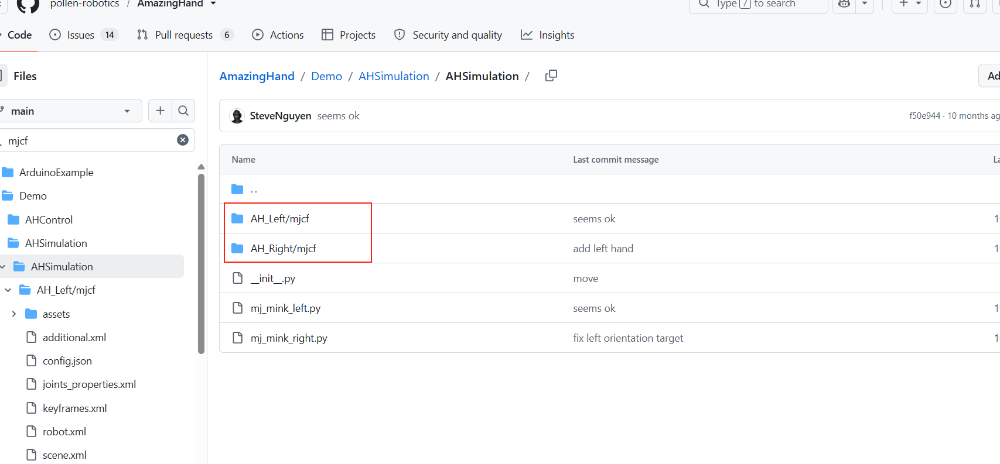

**Double-cliquez sur `1-Install_Env.bat`** ; il effectue automatiquement :

1. **La vérification des outils de compilation MSVC** (cl.exe) — nécessaires pour compiler Rust. S'ils manquent, il propose d'installer
Visual Studio 2022 Build Tools avec la charge de travail « Développement Desktop en C++ », puis de rouvrir le terminal.

2. **L'installation de Rust** (rustup + toolchain stable-msvc)

3. **La configuration du miroir tuna pour cargo** (`C:\Users\<votre-nom-utilisateur>\.cargo\config.toml`) afin d'accélérer le téléchargement des crates

4. **L'installation de uv** (gestionnaire de paquets Python)

5. **L'installation de dora-cli 0.5.0** (`cargo install`, première compilation d'environ 10 à 20 minutes, soyez patient)

6. **L'installation du paquet pip dora-rs** (facultatif, installé dans l'environnement virtuel)

> **Important** : après le script, **fermez puis rouvrez le terminal** pour que les variables d'environnement prennent effet. L'installation peut être lente selon le réseau ; attendez sans interrompre.


### Installation alternative (si les scripts ne sont pas disponibles)

- **Rust** : [https://www.rust-lang.org/tools/install](https://www.rust-lang.org/tools/install)

    - Sous Windows, utilisez rustup-init.exe et choisissez la toolchain MSVC par défaut

    - Variable d'environnement : ajoutez `%USERPROFILE%\.cargo\bin` au PATH

- **uv** : dans PowerShell, exécutez `irm https://astral.sh/uv/install.ps1 | iex`.

    - Variable d'environnement : ajoutez `%USERPROFILE%\.local\bin` au PATH

- **dora-cli** : `cargo install dora-cli --version 0.5.0`

### Configuration du miroir tuna pour cargo (~/.cargo/config.toml)

```bash
[source.crates-io]
replace-with = "tuna"

[source.tuna]
registry = "sparse+https://mirrors.tuna.tsinghua.edu.cn/crates.io-index/"

[registries.tuna]
index = "sparse+https://mirrors.tuna.tsinghua.edu.cn/crates.io-index/"

[http]
check-revoke = false
```

> Utilisez l'**index sparse** (comme ci-dessus), pas un miroir de type dépôt git — la méthode git télécharge d'abord un index d'environ 1 Go et reste souvent bloquée sur `Updating 'tuna' index`.


---

## Câblage

- Reliez la carte de commande de servos au PC en USB, avec une **alimentation externe** (au moins 5V 4A, ou entrée 7–12V selon les exigences de la carte de commande)

- Sur le PC, trouvez le numéro de port : **Gestionnaire de périphériques → Ports (COM et LPT)**, par exemple `COM11`

---

## Configuration du port série (script 2)

**Double-cliquez sur `2-Setup_Serial.bat`** (la logique réelle se trouve dans `2-Setup_Serial.ps1`) :

1. Message « veuillez connecter la carte de commande de servos au PC » → appuyez sur Entrée pour lancer la détection

2. Les ports COM détectés sont listés automatiquement (avec le nom du périphérique)

3. Port unique : appuyez sur Entrée pour confirmer ; plusieurs ports : saisissez le numéro

4. Écrit automatiquement `--serialport` dans les 3 fichiers dataflow yml et le port par défaut dans `AHControl\src\main.rs`

5. Les fichiers d'origine sont sauvegardés automatiquement en `.bak`

> Si vous rebranchez l'USB, le numéro de port peut changer ; relancez alors ce script.


---

## Déploiement du code (script 3)

**Double-cliquez sur `3-Deploy_Demo.bat`** ; il effectue automatiquement :

1. Le démarrage du démon dora (`dora up`)

2. La création d'un environnement virtuel Python 3.12 (`uv venv --python 3.12`)

3. L'activation de l'environnement virtuel

4. La compilation du nœud Rust AHControl (`cargo build --release`, environ 10 minutes la première fois)

5. La synchronisation des dépendances AHSimulation et HandTracking (`uv sync`)

6. L'installation forcée de mediapipe==0.10.14

> Le déploiement ne s'exécute qu'une fois. Une nouvelle exécution demande s'il faut reconstruire l'environnement virtuel.


---

## Exécution du code (script 4)

**Double-cliquez sur `4-Run_Demo.bat`** ; un menu interactif apparaît :

```bash
============================================
   请选择运行模式：
============================================
    1 - 模拟仿真（摄像头手势追踪）
    2 - 真实硬件
    q - 退出
============================================
  请输入序号 [1/2/q]:
```

- Choisissez **1** : environnement de simulation, les gestes de la caméra pilotent deux mains simulées

- Choisissez **2** : sous-menu, choisissez main droite / main gauche / les deux mains

```bash
============================================
   真实硬件 - 请选择灵巧手：
============================================
    1 - 右手
    2 - 左手
    3 - 左右双手
    b - 返回上级菜单
============================================
```

Après le choix, `dora build` + `dora run` s'exécutent automatiquement. La fenêtre de la caméra s'ouvre ; faites des gestes devant la caméra et la main suit en temps réel. **Ctrl+C pour arrêter** ; une fois le flux de données terminé, appuyez sur Entrée pour revenir au menu principal et choisir un autre mode, ou sur `q` pour quitter.

> Au premier lancement, Windows peut bloquer l'accès à la caméra ; cliquez sur « Autoriser ».


---

## Nettoyage du projet (script 0)

**Double-cliquez sur `0-Cleanup_Project.bat`** ; après saisie de `Y` pour confirmer, nettoyage automatique :

1. Arrêt du démon dora

2. Suppression des 3 environnements virtuels (`.venv`)

3. Suppression des produits de compilation Rust (`AmazingHand-main/Demo/target`)

4. Suppression de `pycache`, des sauvegardes `.bak`, des journaux et de `AmazingHand-main/Demo/out` (répertoire des journaux dora)

5. **Restauration du port par défaut** (`--serialport /dev/ttyACM0`), en supprimant les résidus de port série de la machine

> Après le nettoyage, tout le dossier `AmazingHand-main` peut être copié à autrui, propre et sans résidus. Sur une nouvelle machine, exécutez simplement 1 → 2 → 3 → 4 dans l'ordre.


---

## Différences sous Linux et macOS

Les scripts en un clic existent aussi pour Linux et macOS, dans les répertoires `AmazingHand-main/Demo/Linux_Deploy_Scripts/` et `AmazingHand-main/Demo/Mac_Deploy_Scripts/`. Le déroulement des étapes 1 à 4 est identique à Windows ; seules les différences système sont listées ci-dessous.

### Permissions d'exécution des scripts (Linux / macOS)

Après une copie depuis Windows ou une archive, le bit d'exécution `+x` des scripts est perdu ; exécutez d'abord :

```bash
cd "AmazingHand-main/Demo/Linux_Deploy_Scripts"   # sous macOS, remplacer par Mac_Deploy_Scripts
chmod +x *.sh
```

Lancez ensuite avec `./nom_du_script` ; n'utilisez pas `bash nom_du_script`, sinon les invites interactives du script sont ignorées.

### Linux (Ubuntu)

- **Permissions du port série** : `sudo usermod -aG dialout $USER`, puis déconnexion/reconnexion ; en temporaire, `sudo chmod 666 /dev/ttyACM*`.
- **Nom du périphérique** : `/dev/ttyUSB*` (CH340 / CP2102) ou `/dev/ttyACM*` (port série USB embarqué).
- **Caméra** : Paramètres → Confidentialité → Caméra, autorisez l'accès des applications ; vérifiez qu'aucun autre programme n'occupe la caméra.
- **Machine virtuelle** : connectez d'abord la caméra USB à la machine virtuelle ; si OpenCV signale `can't open camera by index` ou `select() timeout`, basculez le contrôleur USB 2.0 / 3.1 dans les paramètres de la VM et redémarrez ; si nécessaire, `sudo usermod -aG video $USER`.
- **Chemin chinois** : utilisez autant que possible un chemin de projet en anglais, pour éviter un échec de chargement des modèles MuJoCo / MediaPipe.


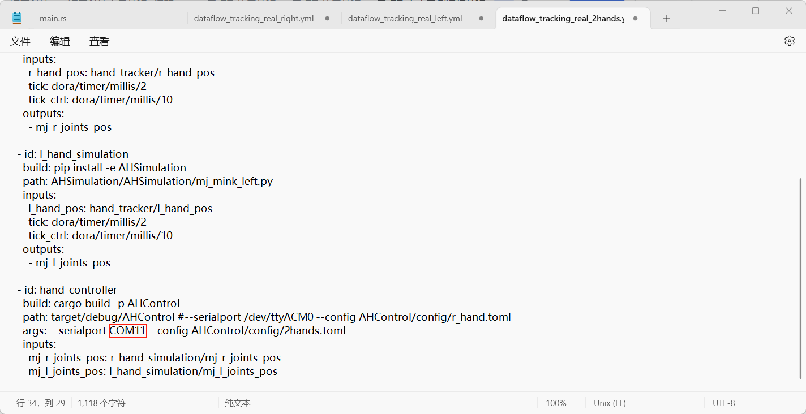

### macOS

- **Port série** : utilisez `/dev/cu.*`, pas `/dev/tty.*` ; `ls /dev/cu.*` pour voir les noms de périphériques.
- **Permissions du port série** : `sudo chmod 666 /dev/cu.usbmodem*`, ou autorisez le terminal dans « Réglages Système → Confidentialité et sécurité → Surveillance des saisies ».
- **Caméra** : au premier lancement, autorisez le terminal à accéder à la caméra ; modifiable aussi dans « Réglages Système → Confidentialité et sécurité → Caméra ».
- **Apple Silicon** : la lenteur de la première compilation `cargo build` des dépendances dora est normale ; si « impossible de vérifier le développeur » s'affiche, cliquez sur « Ouvrir quand même » dans « Confidentialité et sécurité ».


## Installation manuelle (sans les scripts en un clic)

Si les scripts ne sont pas disponibles, déployez manuellement selon la démo officielle :

1. **Obtenir le code** : clonez le dépôt ou téléchargez `AmazingHand.zip`, puis entrez dans `AmazingHand-main/Demo/`.

   
2. **Installer l'environnement** : Rust (rustup), uv, dora-cli ; rouvrez PowerShell/Bash pour que le PATH prenne effet. Détails d'installation dans [Configuration de l'environnement (script 1)](#configuration-de-lenvironnement-script-1) ci-dessus.
3. **Créer l'environnement et installer les dépendances** :

   ```bash
   uv venv --python 3.12
   # Windows : .venv\Scripts\activate
   # Linux/macOS : source .venv/bin/activate

   cd AHControl
   cargo build --release
   cd ..
   cd AHSimulation
   uv sync
   cd ..
   cd HandTracking
   uv sync
   cd ..
   ```

   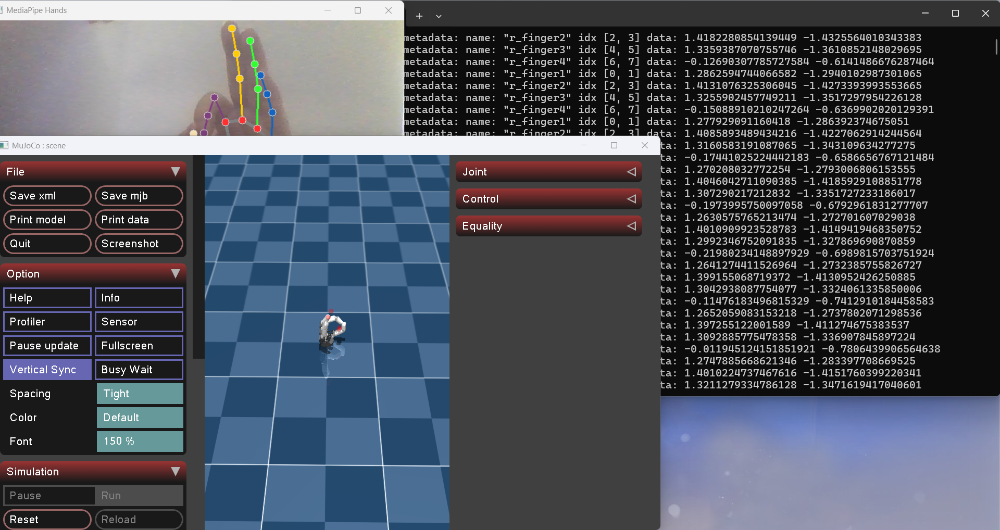
4. **Configurer le port série** : modifiez `--serialport` dans `dataflow_tracking_real_right.yml` / `_left.yml` / `_2hands.yml` en port COM réel, `/dev/ttyUSB0` ou `/dev/cu.usbserial-*`.

   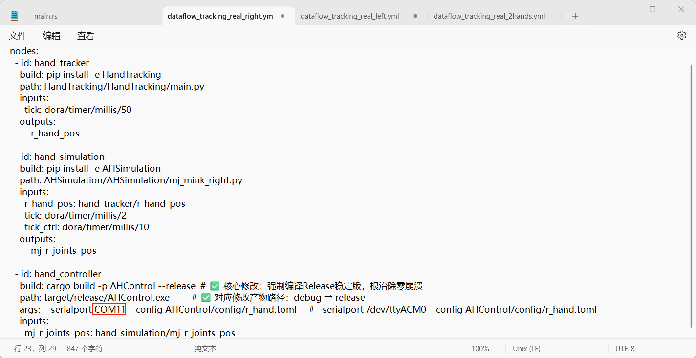

   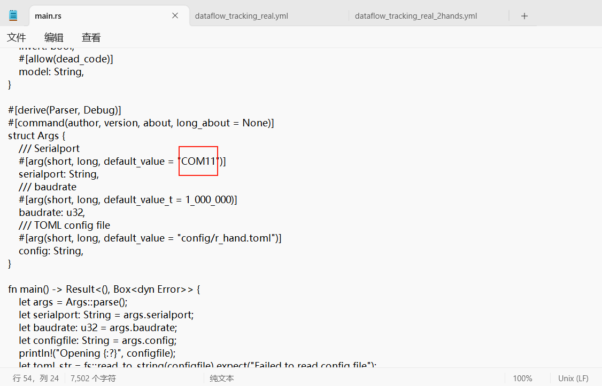
5. **Compiler et exécuter** :

   ```bash
   # simulation
   dora build dataflow_tracking_simu.yml --uv
   dora run dataflow_tracking_simu.yml --uv

   # matériel réel (main droite ; remplacer le nom de fichier pour gauche/deux mains)
   dora build dataflow_tracking_real_right.yml --uv
   dora run dataflow_tracking_real_right.yml --uv

   # exemple d'angles simples
   dora build dataflow_angle_simu.yml --uv
   dora run dataflow_angle_simu.yml --uv
   ```

   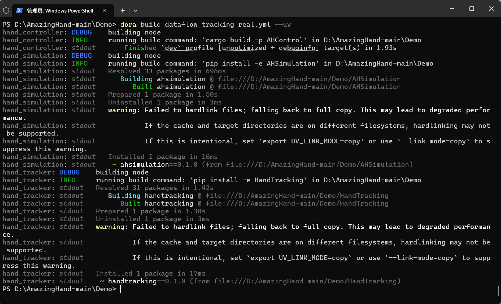

   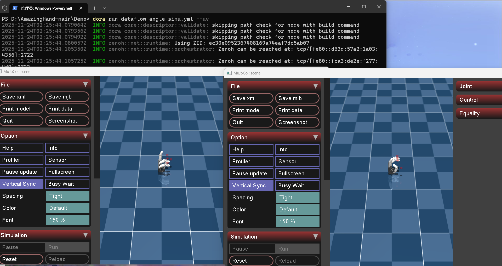

6. **Questions fréquentes** : mediapipe doit être en `0.10.14` (Python 3.12) ; en cas d'incompatibilité de version de dora, alignez selon `pyproject.toml`/les journaux ; s'il manque OpenCV, installez `opencv-contrib-python` ; les permissions caméra, le passthrough USB en machine virtuelle et les chemins chinois peuvent affecter le chargement des modèles. Dépannage détaillé dans [Questions fréquentes et remarques](#questions-fréquentes-et-remarques).

> Les explications officielles plus détaillées de la démo sont dans [`AmazingHand-main/Demo/README.md`](../../../AmazingHand-main/Demo/README.md) ; les étapes de déploiement en un clic de chaque système ont été fusionnées dans cette page.

## Description de la structure du code

### Répertoire Demo

```text
AmazingHand-main/Demo/
├── AHControl/                Nœud Rust : commande série des servos, config/ contient les ID et décalages
├── AHSimulation/             Nœud Python : simulation MuJoCo et cinématique inverse
├── HandTracking/             Nœud Python : reconnaissance des points de repère de main MediaPipe
├── dataflow_*.yml            Orchestration des flux de données dora
├── Windows_Deploy_Scripts/   Scripts de déploiement en un clic Windows
├── Linux_Deploy_Scripts/     Scripts de déploiement en un clic Linux
├── Mac_Deploy_Scripts/       Scripts de déploiement en un clic macOS
└── docs/                     Tutoriels de déploiement multilingues officiels
```

### Correspondance des dataflows

| Fichier de flux | Rôle |
|------------|------|
| `dataflow_tracking_simu.yml` | Suivi des gestes par caméra, pilote uniquement la main simulée MuJoCo |
| `dataflow_tracking_real_right.yml` | Suivi des gestes par caméra, pilote la main droite réelle |
| `dataflow_tracking_real_left.yml` | Suivi des gestes par caméra, pilote la main gauche réelle |
| `dataflow_tracking_real_2hands.yml` | Suivi des gestes par caméra, pilote simultanément les deux mains |
| `dataflow_angle_simu.yml` | Fournit directement les angles d'articulation, pour valider la simulation et la cinématique inverse |

### Principe du flux de données

```bash
Caméra → HandTracking (détection des gestes MediaPipe)
              ↓ coordonnées des points de repère de la main
         AHSimulation (simulation MuJoCo + cinématique inverse)
              ↓ angles cibles des articulations
         AHControl (série → carte de commande de servos → main)
```

### Emplacement de la configuration du port

- La ligne `args:` des trois fichiers `dataflow_tracking_real_*.yml` : `--serialport COMxx`

- `default_value = "COMxx"` dans `AHControl\src\main.rs` (valeur par défaut de l'argument série)

- `AHControl\config\*.toml` : modèle de servo, ID, décalages (généralement inutile à modifier)

---

## Questions fréquentes et remarques

### 1. cargo bloqué sur `Updating 'tuna' index`

- Cause : la configuration du miroir utilise le **mode dépôt git** (`.../git/crates.io-index.git`), qui télécharge un index de 1 Go et plus la première fois

- Solution : remplacez `C:\Users\<votre-nom-utilisateur>\.cargo\config.toml` par l'**index sparse** (voir « Configuration du miroir tuna pour cargo » ci-dessus), ou relancez directement `1-Install_Env.bat`

### 2. Sous-module solutions de mediapipe manquant / installation corrompue

```bash
uv pip uninstall mediapipe
```

```bash
uv pip install mediapipe==0.10.14
```

- À exécuter avec l'environnement virtuel activé (dans le répertoire `Demo`)

- `3-Deploy_Demo.bat` effectue déjà cette opération en solution de repli

### 3. Version de dora incompatible (message v0.8.0 vs v0.7.0)

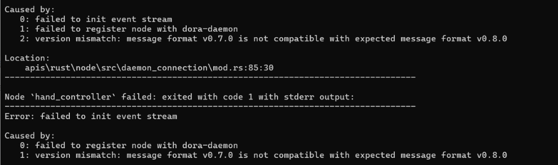

- Symptôme : `version mismatch: message format v0.8.0 is not compatible with expected message format v0.7.0`

- Cause : la version de dora-cli ne correspond pas à dora-node-api. **Les deux doivent être en 0.5.0**

    - Vérification : `dora --version` doit afficher `dora-cli 0.5.0`, `dora-message: 0.8.0`

    - Correction : `cargo install dora-cli --version 0.5.0 --force`

    - Si plusieurs dora sont présents dans le PATH (par ex. une ancienne version dans `C:\Users\<votre-nom-utilisateur>\.dora\bin`), assurez-vous que `.cargo\bin` passe en premier, ou supprimez l'ancienne version

    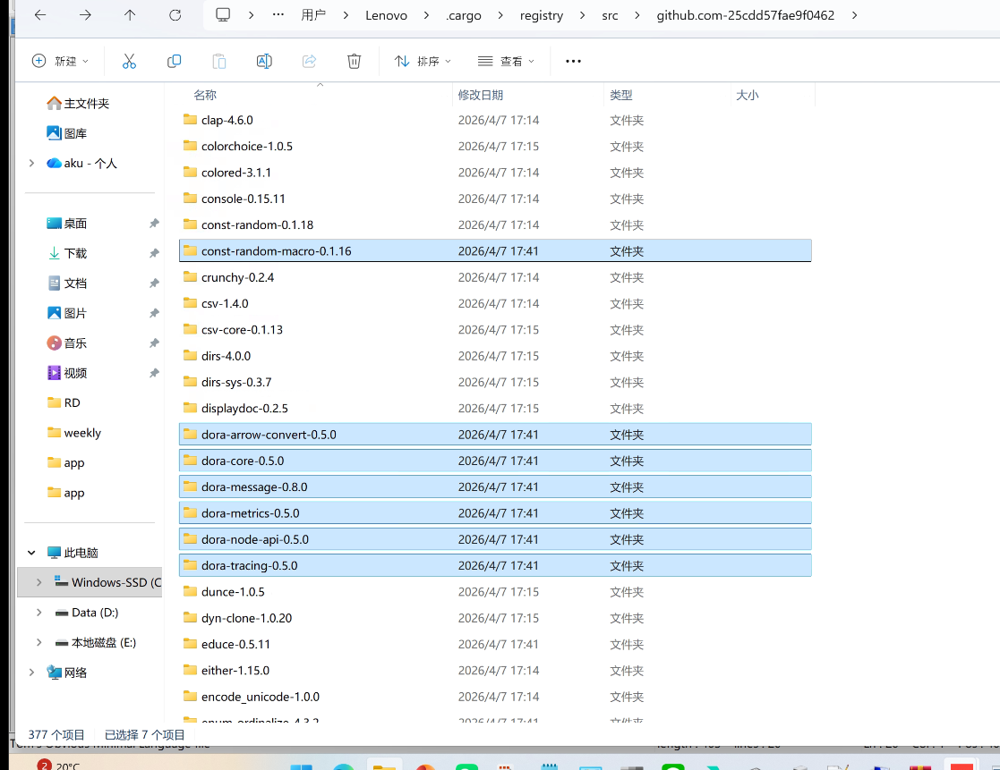

    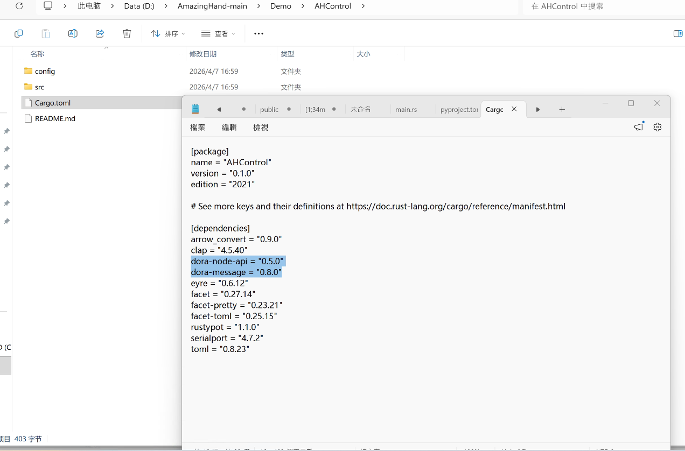

### 4. Échec de chargement des modèles MuJoCo / mediapipe (chemin chinois)

- Symptôme : `ParseXML: Error opening file '...\scene.xml'` ou `Can't find file: ....tflite`

- Cause : les chargeurs C++ de MuJoCo 3.x / mediapipe sous Windows **n'ouvrent pas les chemins absolus contenant du chinois** (par ex. `D:\中文目录...`)

- Ce projet intègre déjà des correctifs :

    - `AHSimulation\AHSimulation\mj_mink_*.py` change de répertoire de travail avant de charger le modèle

    - `HandTracking\mediapipe_patch.py` contourne le problème avec des chemins courts 8.3 + des chemins relatifs

- Ne supprimez pas ces correctifs

### 5. Permissions de la caméra

- Au premier lancement, choisissez « Autoriser » dans la fenêtre

- Paramètres → Confidentialité → Caméra → autoriser l'accès des applications de bureau

  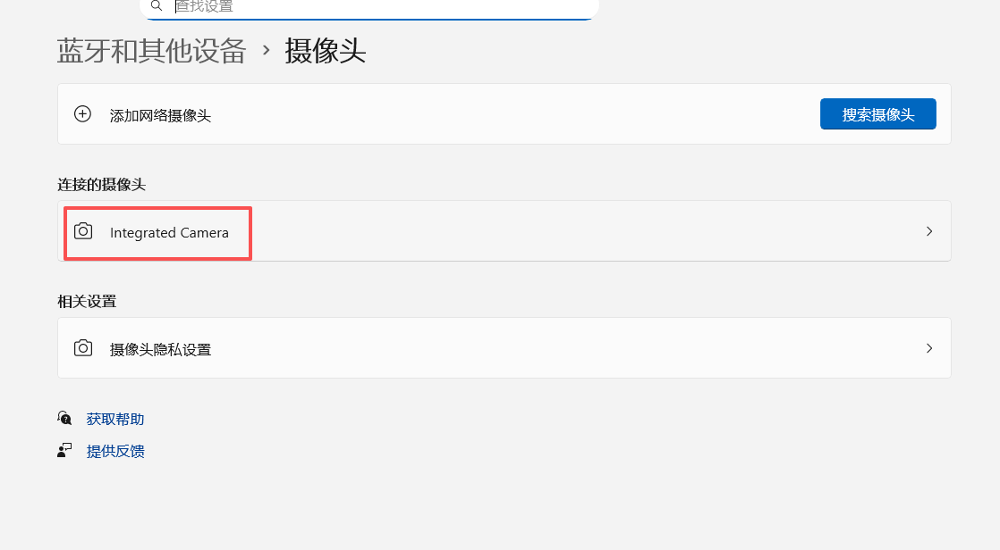

  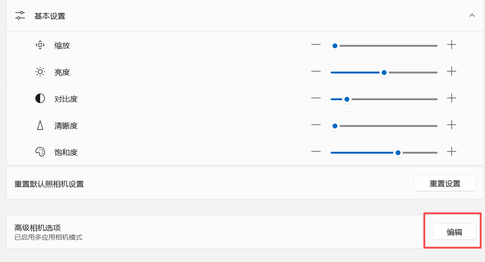

  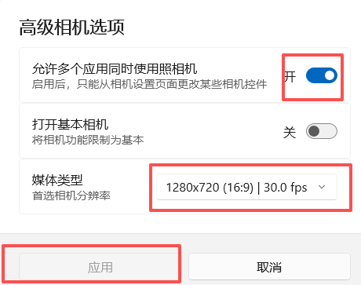

### 6. Le numéro de port change à chaque fois

- Après rebranchement USB, le numéro COM peut changer ; relancez `2-Setup_Serial.bat`

### 7. OpenCV manquant

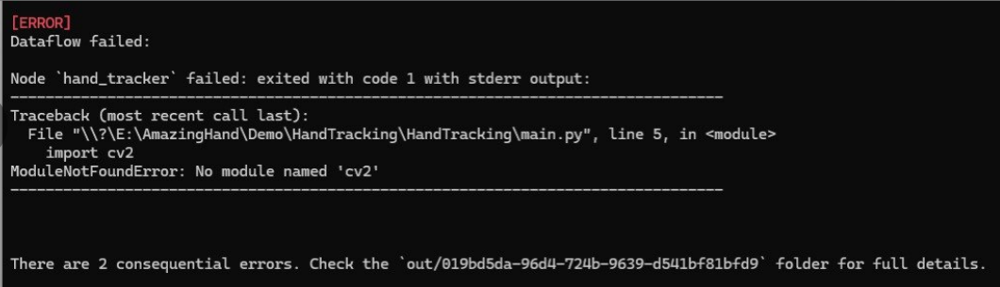

```bash
python -m pip install opencv-contrib-python numpy mediapipe -i https://mirrors.aliyun.com/pypi/simple/
```

(à exécuter dans le répertoire `HandTracking`, après activation de l'environnement virtuel)

---

## Pages associées

- [Démarrage rapide SCS0009](../02-quick-start/scs0009.md)
- [Contrôle web SCS0009](../03-web-control/scs0009.md)
- [Débogage et calibration des servos SCS0009](../06-servo-tuning/scs0009.md)
- [Suivi de main PWM](pwm.md)
