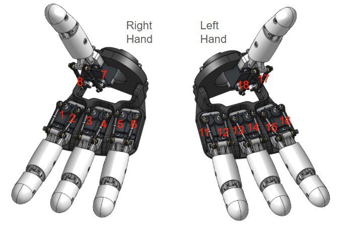

# SCS0009 웹 제어

이 페이지는 웹 제어의 **SCS0009 시리얼 버스 버전** 전용 설명입니다. 공통 UI, 시작 방법, 프리셋 포즈, 카메라 텔레오퍼레이션은 [웹 제어 개요](README.md)를 참고하세요.

## 서보 매핑

데이터 출처: `AmazingHandControl/hand_logic.py`의 `DEFAULT_HAND_SERVOS`와
`docs/zh-hans/CONFIG_FORMAT.md`.

| 손가락 | 오른손 ID | 왼손 ID |
|---|---|---|
| 약지 | 5, 6 | 11, 12 |
| 중지 | 3, 4 | 13, 14 |
| 검지 | 1, 2 | 15, 16 |
| 엄지 | 7, 8 | 17, 18 |

### 두 서보가 함께 손가락 하나를 차동 구동합니다 ⚠️

손가락마다 두 서보는 나란히, 회전축이 같은 선상에 장착되며, **"서보 하나가 굴곡/신전, 다른 하나가 벌림을 담당"하는 것이 아니라** 두 서보가 같은 손가락 하나를 함께 구동합니다:

- 두 서보가 **같은 방향**으로 회전 → 손가락 좌우 벌림(모음/벌림)
- 두 서보가 **반대 방향**으로 회전 → 손가락 펴기 / 굽히기(굴곡/신전)
- 두 서보에 같은 방향과 반대 방향 성분이 동시에 있으면 → 굴곡/신전과 벌림이 중첩됨

```text
벌림(같은 방향)          굴곡/신전(반대 방향)
축1 ↻   축2 ↻         축1 ↻   축2 ↺
```

화면에 표시되는 것은 두 개의 **제어축**이며 두 개의 서보가 아닙니다:

```
굴곡/신전 = (servo1 + servo2) / 2
벌림 = (servo1 − servo2) / 2
```

반대로, 프로그램은 제어축을 두 서보의 목표 각도로 변환합니다:

```
servo1 = 굴곡/신전 + 벌림
servo2 = 굴곡/신전 − 벌림
```

> 여기서 `servo1` / `servo2`는 소프트웨어 목표 각도(짝수 ID는 반대 장착에 따라 부호 반전됨)이며, **서보 출력축의 물리적 방향이 아닙니다**. 두 서보가 실제 기구에서 같은 방향/반대 방향으로 움직이는지는 출력축을 봐야 하며, 이 두 값을 직접 비교해서는 안 됩니다.
>
> 예: 벌림만 `+20`을 주면 소프트웨어 값은 `servo1 = +20`, `servo2 = −20`입니다; 짝수 ID에서 다시 부호를 반전하면 두 서보는 실제로 같은 방향으로 회전합니다.

**"손가락이 벌어지지 않음 / 모이지 않음"은 벌림 제어량이 0이거나 두 서보가 차동을 이루지 못한 것입니다** —
예를 들어 가위 모양 V자는 검지 벌림 `+17`, 중지 벌림 `−30`(하나는 양수, 하나는 음수)에 의존합니다.

범위(공식 포즈 19개 + 중간 위치로부터 도출):

| 축 | 범위 | 설명 |
|---|---|---|
| 굴곡/신전 | −50 ~ +90 | 펼침(음수) ↔ 꽉 쥠(양수) |
| 벌림 | −45 ~ +45 | 모음(음수) ↔ 벌림(양수) |

**두 가지 ID 규칙**(틀리면 서보가 타거나 동작이 반대로 바뀝니다):

1. **홀수 ID는 손가락마다 첫 번째 서보, 짝수 ID는 두 번째 서보입니다.** 양손 모두 성립합니다
   (왼손 11/12, 13/14…도 홀짝이 번갈아 나옵니다). 두 번째 서보는 **반대로 장착**되어 있으므로 변환 시 부호를 반대로 합니다.
2. **왼손 ID는 9–16이 아니라 11–18이며 "약지 우선" 순서로 번호가 매겨집니다.** 1-8로 순서대로 이어서 연결하면 반드시 틀립니다.

> **물리적 방향과 중간 위치**: 오른쪽에서 왼쪽으로 세어 오른쪽이 홀수, 왼쪽이 짝수입니다. 오른손 중간 위치 순서(raw 0–1023) 451,571,451,571,451,571,451,571; 왼손 571,451,571,451,571,451,571,451.



---

## 변환 공식

`AmazingHandControl`의 `apply_pose()`와 완전히 동일합니다(포즈별로 비교 검증 완료):

```
1) mirror_pose가 참이면 먼저 손가락마다 두 서보의 값을 교환
2) servo_deg = (ID 홀수 ? +1 : -1) × (포즈 값 − angle_offset_deg)
```

| 손 | angle_offset_deg | mirror_pose |
|---|---|---|
| 오른손 | `0` | **예** ⚠️ |
| 왼손 | `-35.16` | 예 |

`-35.16°`는 왼손 서보 혼이 오른손 대비 반 칸 어긋난 물리적 차이로, 공식 설정 실측에서 나온 값입니다.

> **`mirror_pose`에 대해 — 이 빌드는 공식과 다릅니다**
>
> 공식 레퍼런스에서는 왼손만 `true`입니다. **이 빌드의 오른손 모듈은 서보 쌍도 반대로 장착**되어 있어 오른손도 `true`로 설정합니다.
>
> 이 교환은 수학적으로 **벌림만 뒤집고 굴곡/신전은 건드리지 않습니다**: `base = (a+b)/2`는 교환해도 변하지 않고, `side = (a−b)/2`는 부호가 바뀝니다.
> 따라서 "어느 한 손의 벌림이 전체적으로 반대"일 때 가장 먼저 볼 스위치가 이것입니다.

포즈 배열은 항상 8개 값이며, 순서는 **`[약지, 중지, 검지, 엄지]`**이고 손가락마다 2개 값입니다 —
공식 `data/hand_config.yaml`과 바이트 단위로 일치해 대조하기 편합니다.

### 실측 변환 결과

| 포즈 | 오른손 | 왼손 |
|---|---|---|
| `open` `[-35]*8` | ID5 **−35** / ID6 **+35** | ID11 **+0.16** / ID12 **−0.16** |
| `close` `[75]*8` | ID5 **+75** / ID6 **−75** | ID11 **+110.16** / ID12 **−110.16** |
| 중간 위치 `[-17.578]*8` | ID5 **−17.58** / ID6 **+17.58** | ID11 **+17.58** / ID12 **−17.58** |

> **왼손 `close`에는 ±110.16°가 필요**하며 오른손보다 훨씬 큽니다. 그래서 `config.json`의 제한을
> **±120°**로 두었습니다(SCS0009 전체 범위는 약 ±150°). 제한을 ±90으로 두면 왼손의 주먹이 잘립니다.

---

## SCS0009 자주 묻는 질문

**동작 방향이 반대** → 배선이 "홀수 ID가 먼저" 규칙을 따르는지 확인하세요; 왼손은 `angle_offset_deg = -35.16`도 확인해야 합니다.

**왼손 주먹이 충분히 쥐어지지 않음 / 서보에서 소리 남** → 제한이 아직 ±90일 수 있으니 `config.json`에서 ±120으로 되어 있는지 확인하세요.

**손가락이 움직이지 않음 / "모터 N개가 필요한데 M개 발견됨" 표시** → `tools/scan_servos.py`를 실행하세요; 왼손 ID가 가장 배선을 틀리기 쉽습니다.

**중간 위치가 어긋남** → 중간 위치 값 `-17.578125`는 공식 raw 451/571에서 변환한 값입니다; 자신의 기계 조립에 맞춰 캘리브레이션하려면 `config.json`의 `middle.positions`를 수정하세요.

## 관련 페이지

- [SCS0009 디버깅과 캘리브레이션](../06-servo-tuning/scs0009.md)
- [SCS0009 데스크톱 제어 프로그램](../04-desktop/scs0009.md)
- [SCS0009 빠른 시작](../02-quick-start/scs0009.md)
