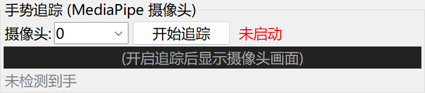

# PWM 손 추적(GUI 내장 MediaPipe)

> 아래 명령은 저장소의 `AmazingHand-PWM/` 디렉터리에서 실행합니다.

이 페이지는 **PWM 서보 버전**의 손 추적을 소개합니다: GUI에 MediaPipe가 내장되어 카메라가 손 랜드마크를 인식하고 실시간으로 PWM 서보 8채널에 매핑합니다. 전체 dora + MuJoCo IK 체인은 SCS0009 공식 Demo에 속하며, [SCS0009 손 추적](scs0009.md)을 참고하세요.

> 체인: 카메라 → MediaPipe 손 스켈레톤 → 네 손가락 굽힘/펴기 각도 → ESP32 → PWM 서보
>
> 적용: ESP32-S3 + PWM 서보 8채널. 펌웨어 플래싱은 [PWM 빠른 시작](../02-quick-start/pwm.md), 프로토콜은 [PWM 프로토콜과 캘리브레이션](../06-servo-tuning/pwm.md)을 참고하세요.

> 전체 IK(MuJoCo + dora + Rust)가 필요한 공식 Demo는 이 모듈과 함께 배포되지 않습니다; 이 튜토리얼은 모듈에 포함된 GUI 내장 추적만 다룹니다.

## 1. 사전 조건

1. **하드웨어**: ESP32-S3 + PWM 서보 8채널에 전원이 들어오고 USB가 연결되며 카메라를 사용할 수 있어야 합니다.
2. **펌웨어**: 이미 플래싱됨([PWM 빠른 시작](../02-quick-start/pwm.md) 참고).
3. **Python**: 64비트 Python 3.12(mediapipe 0.10.14는 64비트 wheel만 제공).

## 2. 추적 의존성 설치

모듈 루트 디렉터리(`AmazingHand-PWM/`)에서 실행하세요:

```bash
tools/setup_tracking.bat
```

스크립트가 자동으로: 64비트 Python 찾기 → `tools/tracking_env` 가상 환경 생성 → `tools/requirements-tracking.txt` 설치(mediapipe 0.10.14, numpy<2, scipy, opencv, Pillow, pyserial) → mediapipe 검증을 수행합니다.

> 수동으로 설치할 수도 있습니다(64비트 Python 3.12 사용):
> ```bash
> python -m pip install -r tools/requirements-tracking.txt
> ```

## 3. 실행

```bash
tools/tracking_env/Scripts/python tools/hand_gui.py
```

1. 상단에서 ESP32의 COM 포트 선택 → "연결" 클릭.
2. "손 추적(MediaPipe 카메라)" 패널로 스크롤합니다.
3. 카메라 번호 선택(기본 0) → "추적 시작" 클릭.
4. 손을 화면에 넣으면 로봇 손이 굽힘/펴기를 따라갑니다; "추적 중지"를 누르면 종료됩니다.



## 4. 원리와 한계

- MediaPipe 0.10.14가 손가락 4개의 끝점에 대한 3D 벡터(손 좌표계)를 추출합니다.
- `hand_tracking.py`의 `tips_to_angles()`가 손가락마다 차동 각도로 매핑합니다:
  - flex(굽힘/펴기): 세 손가락은 z 성분, 엄지는 y 성분을 사용;
  - base(좌우 벌림): 90 고정(좌우 벌림은 아직 구현되지 않음).
- 이들은 **제어축**이며, 전송 시 프로그램이 다시 손가락마다 두 서보의 각도로 합성합니다(같은 방향=벌림, 반대 방향=굴곡/신전).
- GUI 내장 EMA 스무딩(alpha=0.4) + 60 ms 스로틀링으로 떨림을 줄입니다.

한계: IK가 없어 전체 MuJoCo + dora 체인보다 정확도가 낮습니다; 데모와 빠른 시작에 적합합니다.

### 파라미터 캘리브레이션

- `hand_tracking.py` 하단의 `FLEX_SCALE` / `THUMB_FLEX_GAIN`이 굴곡/신전 폭과 방향을 제어합니다(현재 코드 값은 파일 기준).
- 좌우 벌림은 아직 구현되지 않아 `base`가 90으로 고정됩니다; 좌우 벌림이 필요하면 SCS0009 공식 dora Demo를 사용하세요.
- 수정 후 GUI를 재시작해야 적용됩니다.

## 5. 왼손/오른손 전환

GUI 상단에서 "오른손"/"왼손"을 체크합니다. 전환하면 엄지 미러 방향이 달라지며, 반대로 보이면 다른 쪽을 체크해 테스트하세요.

## 6. 자주 묻는 질문

| 현상 | 처리 |
|------|------|
| 서보가 전혀 움직이지 않음 | 전원(5V 3A), COM 포트, 배선 확인; 펌웨어가 플래싱되었는지 확인 |
| 카메라 화면이 나오지 않음 | 카메라 권한 허용(설정→개인정보→카메라) |
| 손을 따라오지 않음 / 둔함 | 조명 충분, 손 전체가 화면에 들어오게, 동작을 천천히 크게 |
| 손 모양이 반대 / 엄지 방향이 반대 | 반대쪽 왼손/오른손을 체크 |
| USB 포트를 바꾼 뒤 시리얼 포트를 찾지 못함 | GUI에서 COM 포트를 다시 선택 |
| 시작하자마자 mediapipe 누락 오류 | `tools\tracking_env\Scripts\python`으로 시작하거나 `tools/setup_tracking.bat`를 다시 실행 |

## 7. 전체 IK / SCS0009 버스 서보

- 전체 IK 체인(카메라 → MediaPipe → MuJoCo + mink IK → AHControl → ESP32)은 별도 dora Demo 프로젝트에서 오며 이 모듈에는 없습니다; 필요하면 원본 배포 패키지 또는 MediaPipe 프로젝트를 사용하세요.
- SCS0009 버스 서보는 저장소의 `Amazinghand-web/`과 `AmazingHandControl/`에서 지원합니다.

## 디렉터리 설명

| 경로 | 내용 |
|------|------|
| `tools/hand_gui.py` | Tkinter 제어 프로그램(제스처, 직접 구동, 차동, 내장 추적) |
| `tools/hand_tracking.py` | MediaPipe 손 추적과 각도 매핑 |
| `tools/setup_tracking.bat` | `tools/tracking_env` 생성과 추적 의존성 설치 |
| `tools/requirements-tracking.txt` | 추적 의존성 목록 |
| `tools/serial_test.py` | 명령줄 시리얼 테스트 |
