# Depuração e calibração de servos SCS0009

A versão SCS0009 tem dois conjuntos de conteúdo de depuração:

1. **Montagem TTL e depuração do meio**: fiação, definição do ID do servo, fixação do horn, ajuste fino do meio, execução dos testes.
2. **Ferramenta de depuração SCS0009**: GUI em Python + PySide6 para escanear o barramento, ler/gravar todos os registradores, controlar a posição, alterar o baudrate/restaurar padrões de fábrica e fazer backup da EEPROM em xdat.

> Detalhes dos registradores do protocolo em [Tabela de memória do protocolo SCS0009](../../../AmazingHandControl/docs/zh-hans/scs_servo_protocol.md).
> Para fiação com Arduino/expansão, veja [Arduino Nano](../07-arduino/arduino-nano.md).

## 1. Depuração TTL: montagem, ID e meio

Primeiro, baixe o pacote "[灵巧手调试.zip](https://juxitech.feishu.cn/wiki/QjYBwL0A0iJVlNkEpUUclLYGnBc)" e, após extrair, use o documento "processo de depuração da mão dexterosa com o programa Arduino (servos TTL)" para definir o ID dos servos, calibrar, ajustar o meio e executar o programa de demonstração, ou consulte o [código oficial de código aberto](https://github.com/pollen-robotics/AmazingHand/tree/main/ArduinoExample).

**Com o produto já montado, sem desmontar** (IDs, calibração e meio ajustados de fábrica), você pode ir direto para [o item 6, executar o "02 演示程序"](#6-executar-o-02-演示程序) e para o [rastreamento de mãos](../05-hand-tracking/scs0009.md).

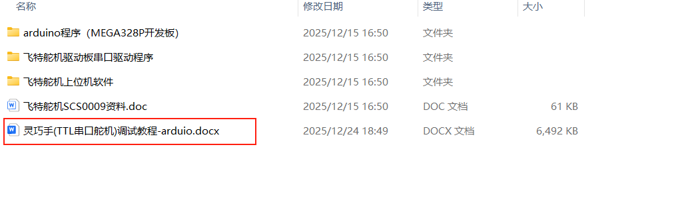

### 1. Formas de fiação para depurar a mão dexterosa

Uma delas é usar o PC executando um software como o aplicativo da Feetech para servos ou um código Python

A outra é usar um microcontrolador como o MEGA328P, ou uma placa de desenvolvimento/controlador comprado por conta própria

As formas de fiação são:

(1) Fiação para depuração via Python (conecta apenas a placa driver de servos):

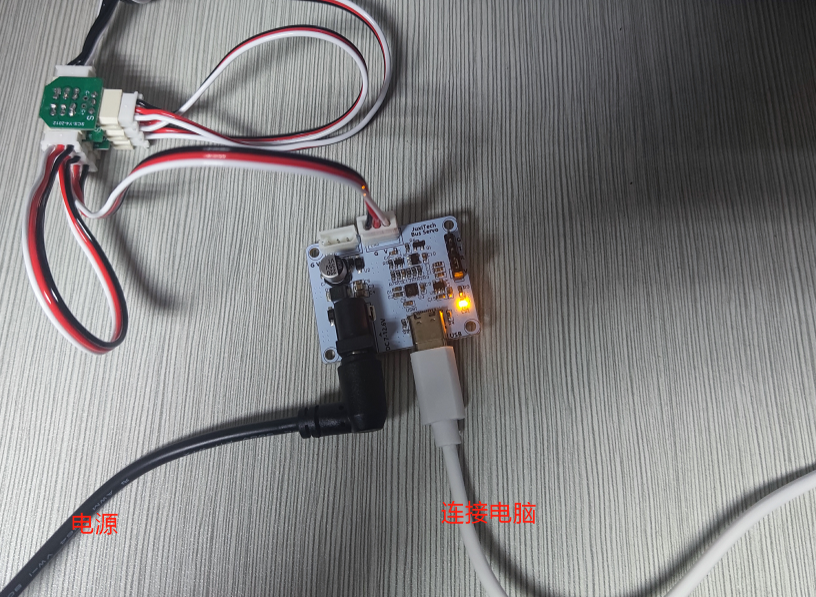

(2) Fiação para depuração com a placa MEGA328P (placa driver de servos + placa 328P):

**Confira com atenção a posição dos pinos da placa MEGA328P!**


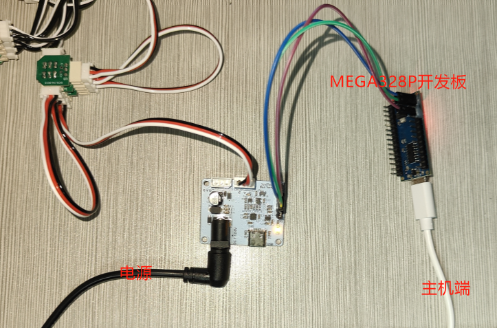


O processo descrito abaixo é o de depuração com microcontrolador; o microcontrolador em si executa o programa de demonstração em loop, e basta desconectar o cabo de dados para parar.

### 2. Definir o ID do servo

Cada mão dexterosa usa 8 servos; os IDs da mão direita devem ser definidos como 1-8 e os da mão esquerda como 11-18

Calibração do meio — padrão de fábrica: mão direita [451,571,451,571,451,571,451,571], mão esquerda [571,451,571,451,571,451,571,451]

1. Fiação: conecte, um a um, **um único** servo e a placa driver de servos.

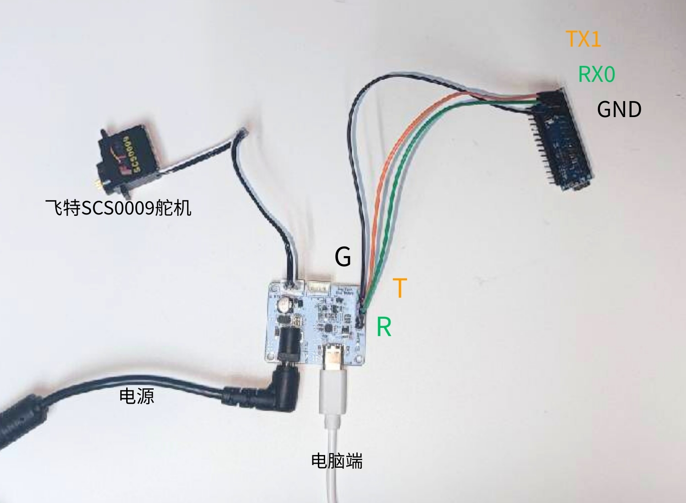

2. Use o software FD1.9.8.2 fornecido pelo fabricante dos servos para fazer a configuração

FD.rar

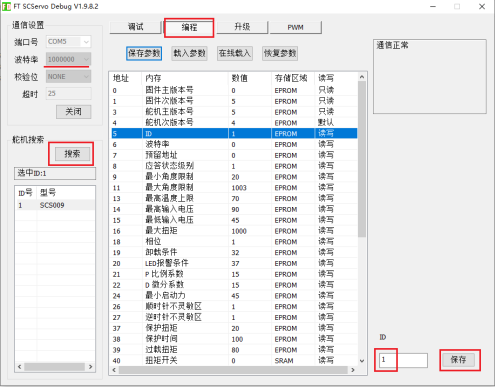

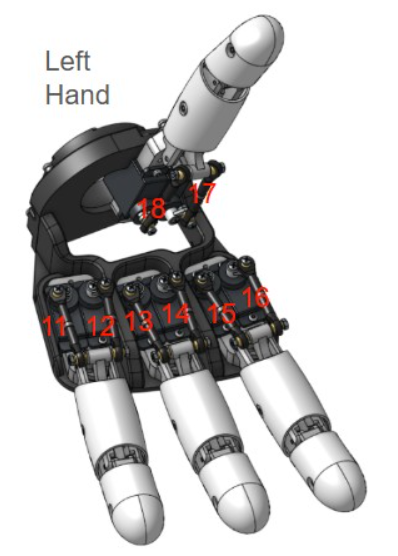

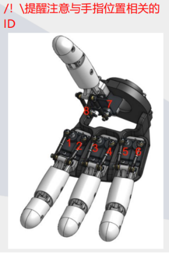

### 3. Fixar o horn do servo

1. Envie para a placa de desenvolvimento o programa "usado ao instalar o horn branco do servo"

Função do programa: colocar a posição das engrenagens do servo aproximadamente no centro; os ângulos de movimento seguintes são todos baseados nessa posição central.

(1) Instale o software Arduino por conta própria; conforme o seu sistema, consulte o [tutorial de instalação](https://blog.csdn.net/weixin_35509395/article/details/156188274). Para compilar e baixar o programa Arduino, primeiro instale as bibliotecas FTServo e SCServo no Gerenciador de Bibliotecas


(2) Tipo de placa: selecione "Arduino Nano"

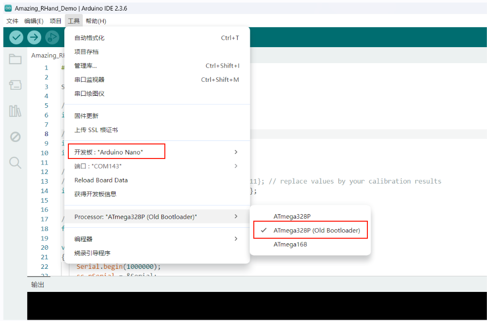

2. Depure os servos 1 e 2

(1) Edição: conforme o ID do servo a depurar, altere a posição a seguir. Por exemplo, para depurar o indicador, defina os IDs como 1 e 2

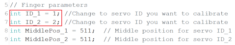

(2) Envie o programa para a placa de desenvolvimento

(3) Fiação: conecte a placa de desenvolvimento à placa driver de servos e aos servos **1 e 2**; você ouvirá as engrenagens do servo girarem um certo ângulo e pararem.

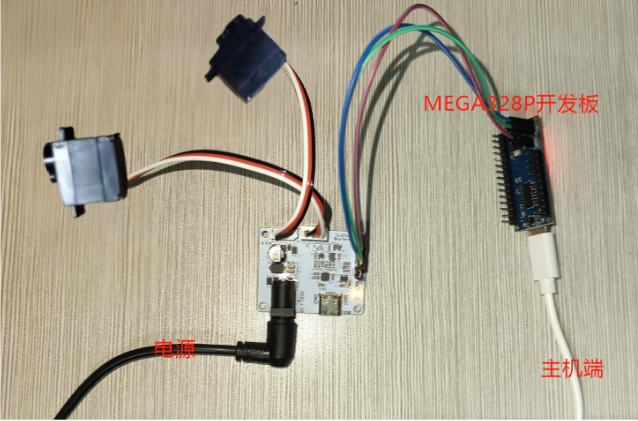

(4) Instale o horn do servo na engrenagem, mantendo-o o mais paralelo possível

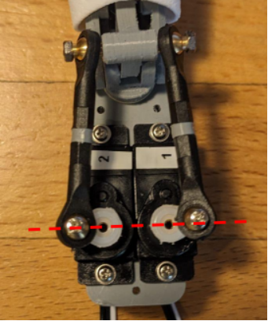

3. Depure os servos 3 e 4

(1) **Desconecte a ligação entre a placa 328P e a placa driver de servos (senão não é possível enviar o programa)**

(2) Edição: defina os IDs como 3 e 4

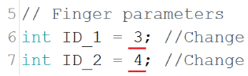

(3) Envie o programa para a placa de desenvolvimento

(4) Fiação: conecte a placa de desenvolvimento à placa driver de servos e aos servos **3 e 4**; você ouvirá as engrenagens do servo girarem um certo ângulo e pararem.

(5) Instale o horn do servo na engrenagem, mantendo-o o mais paralelo possível

4. Depure os servos 5 e 6

Os passos são os mesmos acima

5. Depure os servos 7 e 8

Os passos são os mesmos acima

### 4. Ajuste fino do valor central

1. Envie para a placa de desenvolvimento o programa "usado ao ajustar o valor de MiddlePos"

2. Quando os dedos estiverem na posição fechada, pare o programa imediatamente (basta desconectar o cabo de dados) e verifique se os horns dos servos estão alinhados corretamente (como na figura abaixo). Se não estiverem, ajuste os valores de MiddlePos_1 e MiddlePos_2 no programa até alinhar. Anote o valor (8 valores para os 8 servos); ele será usado no programa final.

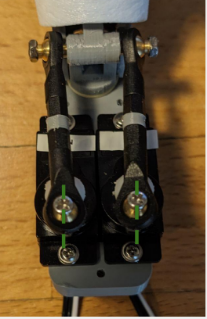

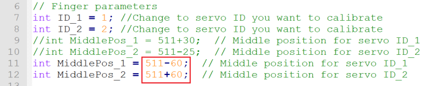

### 5. Executar o programa de teste

1. Preencha os valores de MiddlePos_1 e MiddlePos_2 anotados acima no array abaixo e baixe o programa.

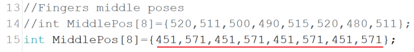

### 6. Executar o "02 演示程序"

(1) Instale o software Arduino por conta própria; conforme o seu sistema, consulte o [tutorial de instalação](https://blog.csdn.net/weixin_35509395/article/details/156188274)

(2) No diretório `灵巧手调试\00 TTL串口舵机\arduino程序（MEGA328P开发板）\02 演示程序`, abra o arquivo .ino correspondente à mão esquerda ou direita

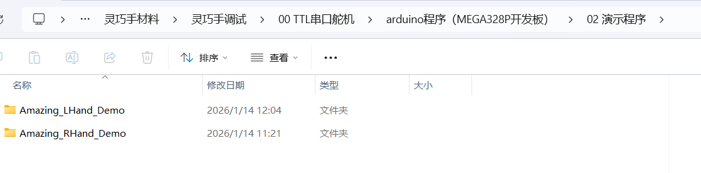

(3) Para compilar e enviar o programa Arduino para a placa, primeiro instale as bibliotecas FTServo e SCServo no Gerenciador de Bibliotecas


(4) Tipo de placa: selecione "Arduino Nano"


(5) Compile e envie

Atenção: neste momento, o PC está conectado apenas à placa de desenvolvimento, e a placa ainda não está conectada à placa driver de servos (ou seja, não está conectada à mão dexterosa)

Após o envio bem-sucedido, conecte a placa de desenvolvimento à placa driver de servos com três jumpers e os servos à placa driver, conforme [a fiação para depuração com a placa MEGA328P](https://juxitech.feishu.cn/wiki/WqxUwGrGHiNi7wkqFkmcCGpXnE?node-id=1758747871229187947&from=from_node_link).

A mão dexterosa executa o **"02 演示程序"** continuamente em loop

O resultado da execução é o seguinte:


---

## 2. Ferramenta de depuração SCS0009

Aplicável ao Windows 10 / 11; para diferenças no Linux e macOS, veja [a seção 8](#8-diferenças-entre-linux-e-macos). Este tutorial cobre cada passo, da instalação do ambiente à depuração completa.

> ⚠️ **Nota de compatibilidade: esta ferramenta atualmente só suporta servos Feetech SCS0009** (série SCS, feedback de posição por potenciômetro, resolução de 10 bits 0–1023). A tabela de registradores e o formato dos parâmetros xdat são específicos para o Feetech SCS0009; outros fabricantes/modelos não têm compatibilidade garantida.

### 1. Requisitos de ambiente

| Dependência | Versão | Descrição |
|------|------|------|
| Python | >= 3.8 | recomenda-se 3.10+, baixe em [python.org](https://www.python.org/downloads/) |
| PySide6 | >= 6.0 | framework da GUI |
| pyserial | >= 3.5 | comunicação serial |
| Sistema | Win10 / Win11 | qualquer versão |

### 2. Instalar o Python

1. Acesse <https://www.python.org/downloads/>
2. Baixe o instalador do Python 3.10+
3. Durante a instalação, **marque obrigatoriamente "Add Python to PATH"** (senão a linha de comando não encontra o python)

Verifique a instalação:

```bash
python --version
```

### 3. Instalar as dependências

Recomenda-se instalar em um ambiente virtual, para não poluir o Python do sistema:

```bash
# entre no diretório do projeto
cd SCS0009_ServoController

# crie o ambiente virtual
python -m venv .venv

# ative o ambiente virtual (Windows)
.venv\Scripts\activate

# instale as dependências
pip install -r requirements.txt
```

> ⚠️ **O ambiente virtual só precisa ser criado uma vez**. Executar de novo sobrescreve o ambiente original (apagando as dependências instaladas). Depois disso, basta `activate` a cada uso.

> Dica: após ativar, o prefixo `(.venv)` aparece na linha de comando.

### 4. Verificar o ambiente

```bash
python setup.py
```

Se aparecer `[OK] 环境检查通过，可以运行项目`, o ambiente está correto.

### 5. Conectar o hardware

1. Conecte o adaptador USB-serial (como CH340 / CP2102) ao computador
2. Conecte o controlador de servos (placa de controle do braço robótico)
3. Alimente os servos (recomenda-se DC 5 V 5 A; na versão Pro, DC 12 V 5 A)

Abra o Gerenciador de Dispositivos (`Win+X` → Gerenciador de Dispositivos) e confirme o número da porta serial:

```
端口 (COM 和 LPT)
  └─ USB-SERIAL CH340 (COM3)     ← sua porta serial do servo
```

> **Anote o número da COM**; ele será escolhido ao iniciar o programa.

### 6. Iniciar a GUI

```bash
python -m src.gui.factory_calibration_tool
```

Ou especifique a porta manualmente (quando a serial estiver ocupada):

```bash
python -m src.gui.factory_calibration_tool --port COM3
```

Veja as portas disponíveis:

```bash
python -m src.gui.factory_calibration_tool --list-ports
```

### 7. Fluxo de operação da interface

> A interface tem layout de painel único; quando a altura da janela é insuficiente, aparece uma barra de rolagem automaticamente, e ao maximizar ela se adapta.

#### 7.1 Conexão serial

- Selecione a porta e o baudrate (padrão 1M) e clique em **Conectar**
- O status mostra `🟢 已连接`

#### 7.2 Escanear servos

- Clique em **Escanear servos** para detectar os servos online com ID 1-254
- O resultado da varredura aparece em tempo real na lista de servos (com o modelo)
- Clique em uma linha da lista de servos → ela é preenchida automaticamente no menu suspenso de servos

#### 7.3 Leitura e escrita de parâmetros

- **Ler parâmetros**: lê todos os 44 registradores (EEPROM + SRAM) e o log mostra o resultado em tempo real
- **Tabela de parâmetros**: 5 colunas (endereço/registrador/valor/área de armazenamento/leitura e escrita), com cores distintas para EPROM/SRAM/DEFAULT
- **Seleção vinculada**: clicar em uma linha da tabela → preenche automaticamente "Endereço de escrita", "Comprimento" e "Valor"
- **Gravar**: após alterar o valor, clique em gravar; o programa desbloqueia/grava/bloqueia automaticamente
- **Janela de resultado da gravação**: sucesso mostra um aviso verde "✅ 已成功写入"; falha mostra um aviso vermelho "❌ 写入失败" (com o motivo)

#### 7.4 Alterar o ID do servo

1. **Deixe no barramento apenas o servo cujo ID será alterado**, para evitar conflito com IDs existentes.
2. Encontre e selecione a linha "ID do servo" (endereço `0x05`) na tabela de parâmetros.
3. Altere o "Valor" para o ID desejado e clique em **✏️ Gravar**; o programa desbloqueia → grava → bloqueia novamente.
4. Depois de alterar, escaneie o barramento novamente para confirmar. Use 1–8 na mão direita e 11–18 na esquerda.

#### 7.5 Controle de posição

1. Arraste o controle deslizante ou digite a posição-alvo (0–1023); a caixa numérica e o controle deslizante ficam sincronizados.
2. Clique em **▶ Mover**; a barra de status mostra "移动中…".
3. Ao chegar, aparece "已移动完成，请关闭力矩"; clique em **⏹ Desligar torque**.

#### 7.6 Baudrate/restauração de fábrica

- **Alterar o baudrate**: selecione o novo baudrate (38400–1000000 bps) e grave; o programa troca o baudrate da serial e valida com ping, revertendo automaticamente em caso de falha.
- **Restaurar padrões de fábrica**: volta aos padrões (ID=1, baudrate 1M); depois é preciso escanear novamente.

#### 7.7 Parâmetros xdat (salva apenas a EEPROM)

1. `💾 保存当前舵机`: salva os parâmetros de EEPROM do servo com o ID atual em um arquivo xdat (backup)
2. `📂 打开 xdat`: carrega o arquivo de backup
3. `📤 恢复参数到舵机`: grava o backup de volta no servo

### 8. Diferenças entre Linux e macOS

#### Linux

- **Fontes**: `sudo apt install fonts-noto-cjk fonts-noto-color-emoji`; caso contrário, a interface em chinês pode aparecer em branco e os emojis como quadrados.
- **Permissões da porta serial**: `sudo usermod -a -G dialout $USER`; vale após logout e login; `groups` deve incluir `dialout`. Temporariamente, use `sudo chmod 666 /dev/ttyUSB0`.
- **Nome do dispositivo**: `/dev/ttyUSB*` (CH340 / CP2102 / PL2303) ou `/dev/ttyACM*` (USB serial embutida); use `lsusb` e `dmesg | grep -i tty` para descobrir o fabricante.
- **Nome de dispositivo fixo (opcional)**: escreva `SUBSYSTEM=="tty", ATTRS{idVendor}=="1a86", ATTRS{idProduct}=="7523", SYMLINK+="ttyServo"` em `/etc/udev/rules.d/99-servo.rules` e depois use `/dev/ttyServo`.
- **Inicialização**: `python -m src.gui.factory_calibration_tool --port /dev/ttyUSB0`.
- **Problemas comuns**: se o `pip` reportar externally-managed-environment, use um venv ou adicione `--break-system-packages`.

#### macOS

- **Python**: recomenda-se instalar com Homebrew (`brew install python`), não use a versão antiga do sistema.
- **Nome da porta serial**: use `/dev/cu.*`, não `/dev/tty.*` (este último pode bloquear); veja com `ls /dev/cu.*`.
- **Driver USB**: CH340 / CP2102 / FTDI geralmente não precisam de driver; lotes antigos de CH340 exigem o driver WCH, que pode ser investigado com `system_profiler SPUSBDataType`.
- **Inicialização**: `python -m src.gui.factory_calibration_tool --port /dev/cu.usbserial-0001`.
- **Apple Silicon**: use Python 3.10+ nativo, evite o Python antigo sob Rosetta; se na primeira execução aparecer «não foi possível verificar o desenvolvedor», permita em «Privacidade e Segurança».
- **Economia de energia**: a hibernação do macOS pode desconectar a serial; mantenha o computador acordado durante a operação.

### 9. Observações

1. **A gravação é persistente**: ao gravar na EEPROM, o valor original é sobrescrito e não pode ser desfeito; faça um backup xdat antes de alterar.
2. **Alimentação estável**: alimentação insuficiente causa perda de passos, falha de comunicação ou perda de contato com o servo; alimente conforme [Fiação e alimentação SCS0009](../01-hardware/scs0009.md).
3. **Uso exclusivo da serial**: a mesma porta não pode ser aberta por dois programas ao mesmo tempo; feche o monitor serial, o aplicativo de PC e outros programas que a estejam usando.
4. **Risco ao alterar o ID**: deixe no barramento apenas o servo cujo ID será alterado; se perder contato após a alteração, tente «restaurar padrões de fábrica» (o ID volta a 1).
5. **Sobretemperatura/sobretensão**: a ferramenta monitora tensão e temperatura (alerta quando a temperatura > 60 °C); em caso de temperatura alta persistente, pare e deixe esfriar.
6. **Hot-plug**: ao desconectar o USB, o programa tenta reconectar; após plugar de novo, clique em atualizar portas.
7. **Caracteres ilegíveis no console do Windows**: se a ferramenta de linha de comando mostrar emojis ilegíveis, defina `PYTHONIOENCODING=utf-8` antes de executar.

### 10. Perguntas frequentes

| Problema | Solução |
|------|------|
| Porta serial não encontrada | Verifique o driver no Gerenciador de Dispositivos; troque a porta USB; instale o driver CH340 |
| Porta serial ocupada | Feche o monitor serial e outros programas; reinicie a ferramenta |
| Fontes chinesas aparecem em branco | O sistema usa Microsoft YaHei por padrão; se houver problema, instale fontes chinesas |
| Servos não são encontrados na varredura | Verifique a alimentação/fiação; confirme o baudrate 1M |
| Falha na gravação | Verifique a alimentação e a conexão do servo; confirme que o registrador-alvo é gravável |
| PermissionError ao abrir a serial | Garanta que nenhum outro processo usa essa porta COM |
| Linux: `Permission denied: /dev/ttyUSB0` | não está no grupo `dialout`; veja a subseção Linux acima |
| macOS: trava quando o nome da serial contém `tty.` | use o dispositivo `/dev/cu.*` correspondente |

### 11. Linha de comando (opcional)

```bash
# lista as portas seriais disponíveis
python -m src.gui.factory_calibration_tool --list-ports

# inicia com a porta especificada
python -m src.gui.factory_calibration_tool --port COM3
```

## Páginas relacionadas

- [Fiação, ID e alimentação SCS0009](../01-hardware/scs0009.md)
- [Início rápido com SCS0009](../02-quick-start/scs0009.md)
- [Aplicativo de desktop SCS0009](../04-desktop/scs0009.md)
- [Controle web SCS0009](../03-web-control/scs0009.md)
