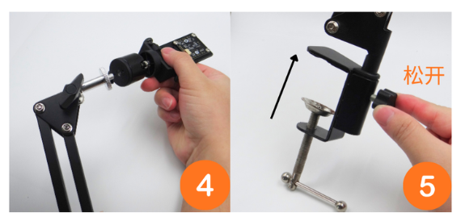
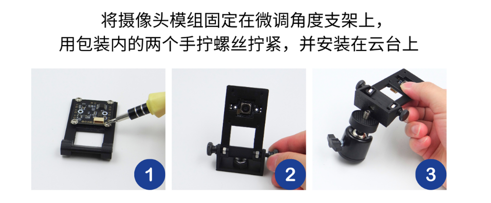
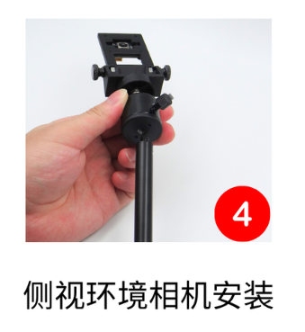

# Instalação do kit de câmara ambiente

Para a depuração da câmara USB com autofoco, consulte o [tutorial da câmara USB com autofoco](https://wiki.juxitech.com/zh-hans/tutorials/accessories/usb-auto-focus-camera).

## Passos de instalação do suporte

1. Fixe primeiro o suporte de ajuste fino do ângulo

   

2. Kit de câmara ambiente de vista lateral

   

3. Kit de câmara ambiente de vista superior

   

## Esquema de instalação oficial

