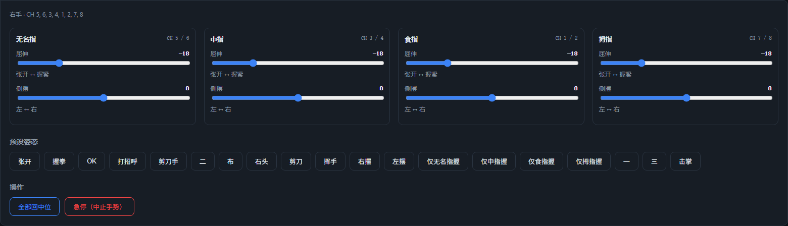

# Controlo web PWM

Esta página é a descrição específica do **PWM (ESP32-S3)** para o controlo web. A interface comum, o modo de arranque, as poses predefinidas e a teleoperação por câmara estão em [Visão geral do controlo web](README.md).

## Hardware e gravação

- Cablagem, GPIO, alimentação e modelo de servo em [Cablagem, GPIO e alimentação PWM](../01-hardware/pwm.md).
- Gravação do firmware (ESP-IDF ou binário pré-compilado) em [Início rápido PWM](../02-quick-start/pwm.md).
- PC↔ESP32 fixo a **115200 8N1**; o servo em si não tem baudrate.

## Ligação pela página web

1. Na lista pendente «Driver» do topo, escolha **PWM (ESP32-S3)**
2. Clique em **Adicionar porta…** e escolha a porta série USB do ESP32-S3
3. Clique em **Ligar**: a página faz automaticamente o handshake (NOP), envia a escolha de mão esquerda/direita e regressa ao centro
4. A partir daí, controle com sliders, poses predefinidas e teleoperação por câmara; os títulos dos dedos mostram **CH 1/2 …** (número do canal PWM)




## Diferenças em relação à versão SCS0009

| Item | Versão de barramento SCS0009 | Versão PWM |
|------|----------------|--------|
| Baudrate da porta série | 1,000,000 | **115,200** |
| Placa controladora | Placa controladora de barramento USB | ESP32-S3 + placa adaptadora PWM |
| Binário | Pode ligar/libertar | **Nenhum** (o firmware não tem comando de binário; o botão fica oculto) |
| Paragem de emergência | Liberta todo o binário | Envia `0xFF` para interromper o gesto; os servos continuam alimentados e mantêm a posição |
| Velocidade | Suporta parâmetro de velocidade | Os frames de acionamento direto não têm parâmetro de velocidade |
| Feedback | Leitura de posição/temperatura/tensão/velocidade | **Sem leitura**; impossível detetar bloqueio ou perda de passos |
| Mão esquerda/direita | IDs de servo diferentes | O mesmo grupo de canais; `0xF1` para alternar (afeta sobretudo os gestos do firmware; as poses da página web usam o mapeamento de cada mão) |

## Calibração de ângulos

A página web converte os valores de pose em 8 ângulos de 0–180°, com a fórmula predefinida:

```
angle = 90 + dir × scale × valor da pose + offset
```

- No primeiro canal de cada dedo `dir = -1`; no segundo canal `dir = +1`
- Por omissão `scale = 1`, `offset = 0`, ou seja, o ângulo do eixo do servo é espelhado diretamente
- Se `mirror_pose` for verdadeiro, trocam-se primeiro os dois valores de pose de cada dedo (ativado neste repositório para as duas mãos)

Se na máquina real o sentido estiver invertido ou o centro desviado, edite `pwm.calibration` do [`config.json`](../../../Amazinghand-web-io/config.json):

```jsonc
"pwm": {
  "calibration": {
    "right": {
      "pointer": { "scale": 1.0, "offset_deg": [0, 0] }
    }
  }
}
```

- Sentido invertido: altere o `scale` do dedo correspondente para `-1`
- Desvio do centro: ajuste `offset_deg` (os dois canais individualmente)
- Passos por dedo: voltar ao centro → arrastar um único dedo → observar o sentido/centro → alterar `scale`/`offset_deg` → atualizar a página e tentar de novo

## Perguntas frequentes

- **Falha de ligação / ESP32 sem resposta**: confirme que o baudrate é 115200, que escolheu a porta COM do ESP32, e a alimentação de 5V/3A e a massa comum; ao abrir a porta série o ESP32 pode reiniciar, e a página volta a tentar o NOP automaticamente
- **Servos não se movem ou tremem**: confirme primeiro que os servos são digitais de 333 Hz (PTK 7452 MG-D ou equivalentes) e que a alimentação é suficiente; o SG90 exige alteração do firmware
- **Sentido invertido**: altere o `scale` do dedo correspondente para `-1`
- **Centro errado**: ajuste o `offset_deg` do canal correspondente
- **Aparece «ocupado (gesto em execução)»**: o firmware está a executar um gesto incorporado; aguarde que termine ou clique na paragem de emergência (`0xFF`)
- **Procurar servos**: `tools/scan_servos.py` só se aplica ao SCS0009; para PWM, utilize `AmazingHand-PWM/tools/serial_test.py` ou a página web

---

## Páginas relacionadas

- [Protocolo e calibração PWM](../06-servo-tuning/pwm.md)
- [Aplicação de desktop PWM](../04-desktop/pwm.md)
- [Início rápido PWM](../02-quick-start/pwm.md)
