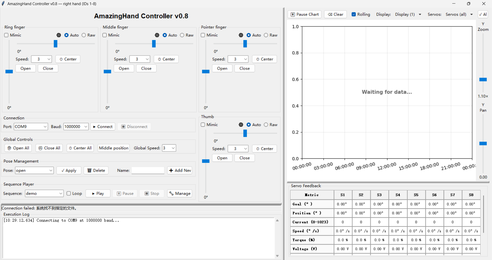
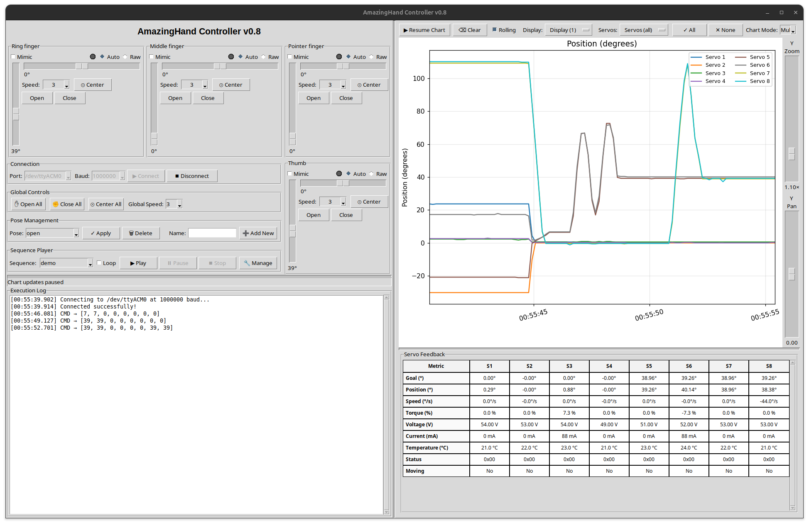
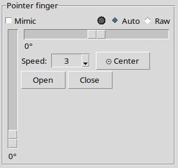
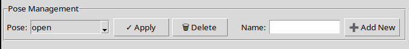
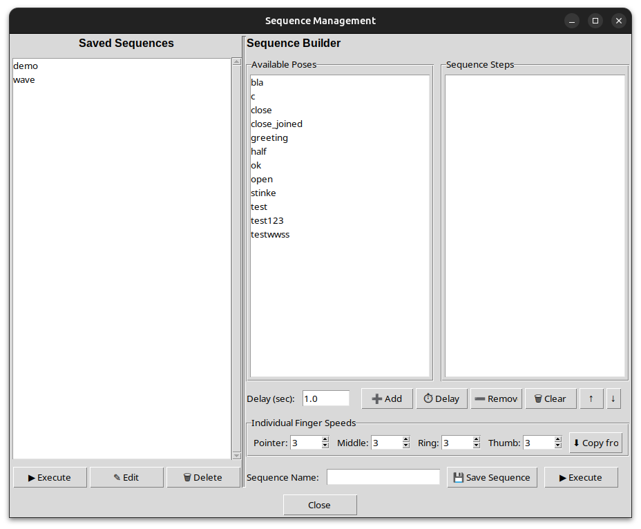
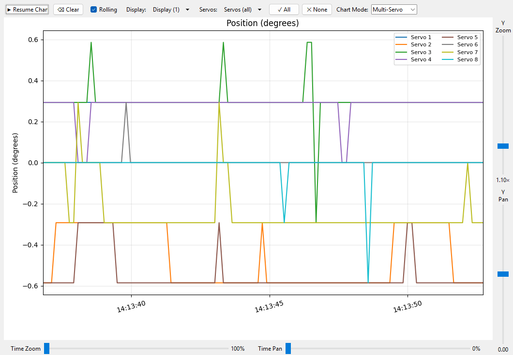
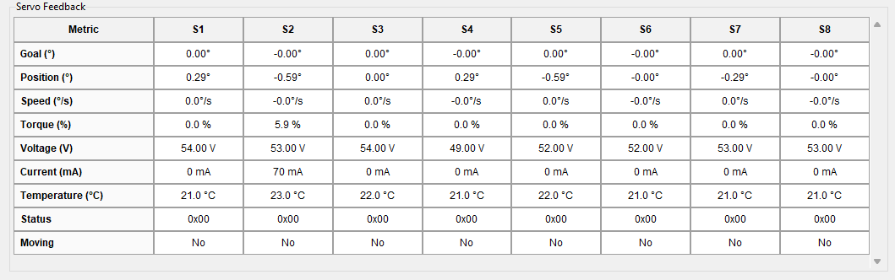

# Aplicação de desktop SCS0009 (GUI e CLI)

> Esta página é o tutorial de controlo de desktop da **versão de barramento série SCS0009**. Para controlo web, consulte [Controlo web SCS0009](../03-web-control/scs0009.md); para cablagem de hardware, [Cablagem SCS0009](../01-hardware/scs0009.md).

## Início rápido

1. Instale Python 3.10+ e as dependências: [Instalação](#instalação).
2. Ligue a placa controladora de barramento e confirme a porta série: [Requisitos de ambiente](#requisitos-de-ambiente).
3. Execute a GUI: `amazing-hand-gui` ou `python amazing_hand_gui.py`.
4. Verifique a mão esquerda/direita, os ângulos e a posição central segundo a [Calibração](#calibração).
5. Execute movimentos com os sliders de cada dedo, poses predefinidas e sequências.


## Ferramenta de controlo AmazingHand em Python (aplicável à mão esquerda e direita)

Ferramenta GUI e de linha de comandos escrita em Python, que controla 8 servos Feetech SCS0009 através de uma placa controladora de servos de barramento série, acionando a mão robótica de destreza [AmazingHand da Pollen Robotics](https://github.com/pollen-robotics/AmazingHand).

> **Suporta as duas mãos.** No arranque, escolha a mão direita (IDs de servo 1-8) ou a esquerda (IDs de servo 11-18); `--hand` permite saltar a pergunta. A biblioteca de poses é partilhada pelas duas mãos; cada mão mantém no data/config.yaml o seu próprio mapeamento de servos, desvio de montagem e alvos de valores brutos. Consulte a seleção da mão esquerda/direita para mais detalhes.



---

## Estrutura do projeto

```text
amazing_hand_gui.py   – Programa principal da GUI
amazing_hand_cmd.py   – Ferramenta de linha de comandos
hand_logic.py         – Lógica de negócio partilhada (independente da UI)
pyproject.toml        – Metadados do pacote, dependências, configuração do pytest
data/
  config.yaml         – Definições da aplicação (porta série, limites, alvos de valores brutos)
  hand_config.yaml    – Gestos e sequências guardados
docs/
  REQUIREMENTS.md       – Requisitos e critérios de aceitação
  CONFIG_FORMAT.md      – Descrição do formato dos ficheiros de configuração
  scs_servo_protocol.md – Referência dos registos do SCS0009
  CHANGES.md            – Alterações face à versão original e respetivas razões
  user_manual.md        – Página de redirecionamento para o tutorial central
tests/
  test_hand_logic.py      – Testes unitários do hand_logic (155 itens)
  test_gui_utils.py       – Testes unitários das funções utilitárias da GUI (51 itens)
  test_cmd.py             – Testes unitários da CLI (42 itens)
  test_integration.py     – Testes de integração (14 itens)
  test_system.py          – Testes de sistema por subprocesso (22 itens)
  test_system_hardware.py – Testes de hardware (33 itens, requer --hardware)
  test_cmd_hardware.py    – Testes de hardware da CLI (21 itens, requer --hardware)
```

## Requisitos de ambiente

- Python 3.10 ou superior (a GUI requer Tkinter incluído)
- Alimentação externa de 5V independente para os 8 servos
- Adaptador de barramento série USB com driver instalado

## Instalação

Recomenda-se a instalação com pip (lê o pyproject.toml):

```bash
pip install -e .
```

Ou instale diretamente as dependências:

```bash
pip install -r requirements.txt
```

Ambiente de desenvolvimento e testes:

```bash
pip install -r requirements-dev.txt
```

---

## Calibração

O sistema de ângulos, as poses predefinidas e a posição central dos servos dependem da mão concreta. Todos estes parâmetros estão concentrados em data/config.yaml.

### Seleção da mão esquerda/direita

As duas mãos usam servos e estruturas mecânicas diferentes, pelo que a escolha aparece antes da interface:

```text
  AmazingHand — which hand?
    1 = right hand  (servo IDs 1-8)
    2 = left hand   (servo IDs 11-18)
  Enter 1 or 2 [1]:
  LEFT hand — servo IDs 11-18
    Ring (11, 12)  Middle (13, 14)  Pointer (15, 16)  Thumb (17, 18)
    middle position raw: [571, 451, 571, 451, 571, 451, 571, 451]
```

Saltar a pergunta:

```bash
python amazing_hand_gui.py --hand left
python amazing_hand_cmd.py --pose victory --hand left
```

Sem `--hand`, é utilizado o valor `hand:` do data/config.yaml.

**Porque é que uma mão não é apenas outro grupo de IDs.** Além da numeração dos servos (mão direita 1-8, mão esquerda 11-18, e na mão esquerda a numeração dos dedos é espelhada — o anelar vem primeiro), a mão esquerda tem ainda duas diferenças mecânicas, tratadas automaticamente pelo programa:

|  | Mão direita | Mão esquerda |
|---|---|---|
| ID do servo | 1-8 | 11-18 |
| Dedo → ID | Indicador 1,2 / Médio 3,4 / Anelar 5,6 / Polegar 7,8 | Anelar 11,12 / Médio 13,14 / Indicador 15,16 / Polegar 17,18 |
| MiddlePos do fabricante | [451, 571, …] | [571, 451, …] |
| Desvio de montagem | 0° | **−35.16°** (hands.left.angle_offset) |
| Par de servos do mesmo dedo | (a, b) | **(b, a)** (hands.left.mirror_pose) |

Se faltar qualquer um destes dois últimos itens, qualquer gesto fica deformado: o desvio de montagem faz cada dedo desviar 35°, e sem a troca do par do mesmo dedo a direção de abertura inverte-se totalmente (no gesto em V, os dois dedos juntam-se, e os três dedos que deviam juntar-se abrem-se).

data/hand_config.yaml é **partilhado pelas duas mãos** e armazena sempre a ordem da mão direita; a mão esquerda é convertida na leitura e reconvertida na gravação.

**Calibrar uma mão nova.** Use como modelo os valores em hands.left e verifique nesta ordem:

1. Prima **Middle position** e veja se a linha Current (0-1023) lê os valores brutos esperados
1. Prima **Open All** / **Close All** — o curso deve atingir o limite mecânico sem bloqueio
1. Experimente uma pose de abertura (victory abrindo um V, greeting com três dedos juntos)

Se algo estiver errado, qual o parâmetro a ajustar:

| Sintoma | O que alterar |
|---|---|
| Leitura de Middle position errada | hands.<nome>.raw_positions.middle |
| Direção de abertura invertida | hands.<nome>.mirror_pose |
| Curso insuficiente ou excessivo | hands.<nome>.raw_positions.open / close |

### Sistema de ângulos

A GUI e a CLI usam **valores de ângulo**, convertidos pelo driver rustypot nos valores brutos internos dos servos:

```text
raw = 1024 × angle / 300° + 511        (0.29297°/step, intervalo de valores brutos 0–1023)
```

| Ângulo | Significado |
|---|---|
| **−35°** | Totalmente aberta (esticada) |
| **0°** | Posição central, dedos naturalmente ligeiramente fletidos |
| **+75°** | Totalmente fechada (punho) |

Os dois servos de cada dedo ficam lado a lado, com eixos colineares: **a rotação no mesmo sentido produz abertura; a rotação em sentidos opostos produz flexão**. Os servos de ID par são **invertidos** em relação aos de ID ímpar, pelo que o mesmo valor de abertura/fecho faz os dois servos moverem-se em sentidos opostos; isto é tratado automaticamente pelo programa, sem necessidade de conversão manual.

### Limites

```text
limits:
  servo_min: -75      # limite superior e inferior absoluto do curso de qualquer comando de servo
  servo_max: 75
  base_min: -75       # intervalo do slider de abrir/fechar
  base_max: 75
  side_min: -35       # intervalo do slider lateral
  side_max: 35
```

side_min/side_max controlam **a abertura lateral**. Como o programa normaliza (u = |side_offset| / |side_min|), **alterar apenas este intervalo não altera a amplitude real de abertura**, apenas comprime a escala do slider. Para alterar efetivamente o ângulo de abertura dos dedos, é obrigatório modificar também auto_extremes.

### Alvos de valores brutos

Os três botões de posição globais levam os servos a **valores brutos exatos**, sem passar pelo modelo de ângulos:

```text
raw_positions:              # índice 0 -> ID de servo 1 …… índice 7 -> ID de servo 8
  open:   [260, 760, 260, 760, 260, 760, 260, 760]
  close:  [760, 260, 760, 260, 760, 260, 760, 260]
  middle: [451, 571, 451, 571, 451, 571, 451, 571]
```

- open / close —— os dois extremos do curso mecânico. Medidos com a ferramenta de depuração Feetech do fabricante, acionando cada servo individualmente.
- middle —— **a posição central mecânica calibrada** (ou seja, o MiddlePos do programa de demonstração Arduino oficial). Note que **não é** o ponto médio entre open e close, mas sim desviado cerca de **±60 raw (±17.6°)** em relação ao raw 511.

> Estes são **valores de calibração de cada mão**. As palavras do fabricante são *"replace values by your calibration results"*.

**Como verificar:** o painel Servo Feedback tem uma linha Current (0-1023) que mostra em tempo real a posição bruta. Depois de premir o botão **Middle position**, esta linha deve ler 451, 571, 451, 571, ….

### Gama de controlos (referência rápida)

| Controlo | Intervalo |
|---|---|
| Slider de abrir/fechar (vertical) | −75 … +75 |
| Slider lateral (horizontal) | −35 … +35 |
| Velocidade | 1 (lento) … 6 (rápido) |

O valor de velocidade é transmitido ao servo como rad/s; portanto, 1–6 corresponde aproximadamente a **57–344 °/s**. Com carga, a velocidade real é cerca de **70%** desse valor —— tenha isso em conta ao definir os atrasos das sequências.

---

## Executar a GUI (amazing_hand_gui.py)



A interface está dividida em quatro áreas:

- **Coluna esquerda**: painéis de controlo por dedo dos quatro dedos, com sliders de abrir/fechar e lateral, modos Auto/Raw, velocidade, Open/Close/Center.
- **Coluna central**: botões de controlo globais (Open All / Close All / Center All / Middle position) e gestão de poses.
- **Coluna direita**: gráficos de telemetria e tabela de feedback Servo Feedback (posição, carga, temperatura, tensão).
- **Parte inferior**: registo de execução e barra de estado, com estado da ligação, progresso da ação e mensagens de erro.

Após a instalação com pip, pode chamar diretamente:

```text
amazing-hand-gui
amazing-hand-gui --port /dev/ttyUSB0
```

Ou executar diretamente:

```bash
python amazing_hand_gui.py
python amazing_hand_gui.py --port /dev/ttyUSB0
```

A lista pendente de portas lista as portas série **realmente existentes** na máquina (dá prioridade a pyserial; se não existir, lê o registo do Windows), pelo que adaptadores com números mais altos também aparecem. A lista pendente permite introduzir o número da porta manualmente. Quando a porta predefinida da configuração não está ligada, a GUI arranca automaticamente na primeira porta real; para fixar uma porta, passe `--port` explicitamente.

### Funcionalidades



- Sliders por dedo para controlar abrir/fechar e lateral, com dois modos: **Auto** (abrir/fechar + lateral) e **Raw** (controlo direto dos ângulos dos dois servos)

  > Os dois sliders do **modo Auto** são eixos de controlo, combinados automaticamente pelo programa em diferencial; o **modo Raw** aplica diretamente os ângulos aos dois servos. Os dois servos de cada dedo ficam lado a lado, com eixos colineares: a rotação no mesmo sentido produz abertura; a rotação em sentidos opostos produz flexão.

- Botões rápidos Open / Close / Center por dedo
- Seleção de velocidade por dedo (1–6), e também uma lista pendente global de sincronização de velocidade
- Atalhos de teclado para ajustes precisos
- **Botões de posição globais**: Open All, Close All, Center All, Middle position
- Gestão de gestos e sequências baseada em data/hand_config.yaml
- Possibilidade de eliminar diretamente na interface gestos guardados (botão 🗑 Delete)
- Gráficos de telemetria dos servos em tempo real (posição, carga, temperatura, tensão)
- Tabela Servo Feedback com **posição bruta** em tempo real (0–1023), útil para verificação da calibração

### Operação por teclado

- **1-4**: selecionar o dedo (Ring anelar, Middle médio, Pointer indicador, Thumb polegar)
- **Teclas de direção**: mover o dedo selecionado
  - Cima/baixo: fechar / abrir
  - Esquerda/direita: mover lateralmente
- **Teclas modificadoras**:
  - Nenhuma: 1° por vez (ajuste fino)
  - Shift: 5° por vez (normal)
  - Ctrl: 10° por vez (rápido)
- **Ações rápidas**:
  - Q: fechar completamente o dedo selecionado
  - E: abrir completamente o dedo selecionado
  - C: recentrar o desvio lateral

### Botões globais

| Botão | Abrir/fechar | Lateral |
|---|---|---|
| ✋ **Open All** | Todos os dedos para o valor bruto open | Recentrar |
| ✊ **Close All** | Todos os dedos para o valor bruto close | Recentrar |
| ⊙ **Center All** | **Mantém-se inalterado** | Recentrar |
| ⊙ **Middle position** | Todos os dedos para o valor bruto middle | Recentrar |

A lista pendente **Global Speed** (1–6) aplica imediatamente a velocidade selecionada a todos os controlos dos dedos e sincroniza a apresentação dos sliders de cada dedo.

Os três botões de valores brutos (Open All, Close All, Middle position) contornam o modelo de ângulos, pelo que **após a execução os sliders mostram o valor representável mais próximo, e não o valor exato**. Se depois tocar nos sliders, a mão desvia-se do alvo bruto em cerca de 0,3° no máximo —— um compromisso deliberado para acertar com precisão nas posições calibradas.

> Problema conhecido: o Center All **não** ignora os dedos em modo **Raw**, sobrepondo-se aos ângulos brutos definidos manualmente. O botão ⊙ Center de um único dedo não tem este problema.

---

## Executar a CLI (amazing_hand_cmd.py)

Ferramenta de linha de comandos autónoma que permite aplicar poses e reproduzir sequências sem iniciar a GUI. Lê o mesmo data/hand_config.yaml da GUI e **envia literalmente** os valores de pose guardados —— exatamente os mesmos que a GUI envia.

### Linux: permissões da porta série

Os adaptadores de porta série USB aparecem normalmente como /dev/ttyACM0 (Waveshare / CDC-ACM) ou /dev/ttyUSB0 (FTDI / CH340).

Como encontrar:

```bash
ls /dev/ttyACM* /dev/ttyUSB* 2>/dev/null
# ou
dmesg | grep -E 'ttyACM|ttyUSB' | tail -5
```

Se aparecer **Permission denied**, adicione o utilizador atual ao grupo dialout e inicie sessão novamente:

```bash
sudo usermod -aG dialout $USER
```

### Após instalação com pip

```text
amazing-hand-cmd --list
amazing-hand-cmd --pose open
amazing-hand-cmd --sequence demo --loop
amazing-hand-cmd --pose open --speed 6
# quando necessário, substituir a porta série:
amazing-hand-cmd --pose open --port /dev/ttyUSB0
```

### Execução direta

```bash
python amazing_hand_cmd.py --list
python amazing_hand_cmd.py --pose open
python amazing_hand_cmd.py --pose close --speed 6
python amazing_hand_cmd.py --sequence demo
python amazing_hand_cmd.py --sequence wave --loop
python amazing_hand_cmd.py --port /dev/ttyUSB0 --pose open
python amazing_hand_cmd.py --list --config /path/to/hand_config.yaml
```

### Parâmetros

| Parâmetro | Valor predefinido | Descrição |
|---|---|---|
| --pose NAME | – | Aplica a pose com o nome indicado |
| --sequence NAME | – | Reproduz a sequência com o nome indicado |
| --list | – | Lista todas as poses e sequências |
| --loop | Desligado | Reproduz a sequência em ciclo até Ctrl+C |
| --speed N | 3 | Velocidade do servo 1 (lento)… 6 (rápido) |
| --port PORT | Linux /dev/ttyACM0<br>Windows COM9 | Número da porta série |
| --baudrate N | 1000000 | Baudrate |
| --config PATH | data/hand_config.yaml | Especifica outro ficheiro de configuração |
| --hand {right,left} | hand do config.yaml | Especifica a mão a usar (direita 1-8, esquerda 11-18) |

Ao sair (incluindo Ctrl+C), o script desliga automaticamente o binário de todos os servos.

> A CLI não tem um parâmetro --config correspondente ao data/config.yaml; esse ficheiro é sempre carregado do diretório do projeto.

---

## Ficheiros de configuração

### data/config.yaml

| Secção | Finalidade |
|---|---|
| serial | Porta série predefinida de cada plataforma, baudrate, lista de baudrates possíveis |
| servos | IDs de servo correspondentes a cada dedo |
| limits | Intervalos de ângulo dos servos e dos dois sliders |
| speeds | Valores predefinidos/mínimos/máximos da escala de velocidade 1–6 |
| auto_extremes | Posição dos servos quando os sliders laterais atingem o limite |
| raw_positions | Alvos brutos exatos dos botões de posição globais |
| paths | Localização dos ficheiros de gestos/sequências |

### Correspondência entre servos e dedos

| Dedo | ID do servo | Índice no array de pose |
|---|---|---|
| Pointer indicador | 1, 2 | 4, 5 |
| Middle médio | 3, 4 | 2, 3 |
| Ring anelar | 5, 6 | 0, 1 |
| Thumb polegar | 7, 8 | 6, 7 |

**A ordem do array de pose é anelar, médio, indicador, polegar, e não por ID de servo.** Este é o ponto mais fácil de errar ao editar manualmente o hand_config.yaml.

> O comentário no topo do amazing_hand_cmd.py diz "index 0→servo1 … 7→servo8"; **esse comentário está errado**; a tabela acima é o comportamento real do código.

---

## Gestos e sequências



Todos os gestos e sequências são guardados em data/hand_config.yaml. Se o ficheiro não existir, a GUI cria-o automaticamente.

### Guardar um gesto

1. Coloque a mão na pose desejada com os sliders ou o teclado
1. Preencha o nome na caixa "Name:"
1. Clique em "➕ Add New" na área Pose Management

A velocidade só afeta a rapidez de movimento dos sliders; o gesto guardado regista apenas as 8 posições dos servos.

### Carregar / eliminar gestos

- Selecione na lista pendente e clique em **✓ Apply** para mover a mão para essa pose
- Clique em **🗑 Delete** à direita de Apply e, após confirmação, elimine permanentemente

### Gestão de sequências

1. No Sequence Player, clique em "🔧 Manage" para abrir o gestor de sequências
1. **Saved Sequences** (coluna esquerda)
  - Ver, executar, editar ou eliminar sequências existentes
  - Duplo clique ou clique em "▶ Execute" para executar uma vez

1. **Sequence Builder** (coluna direita)
  - Duplo clique num gesto de "Available Poses" para o adicionar como passo
  - Pode definir individualmente a velocidade e o atraso dos 8 servos para cada passo; os passos são guardados no formato "pose:s1,s2,...,s8|delay"
  - Use ↑/↓ para reordenar, ou o botão "⏱ Delay" para inserir uma pausa independente
  - Depois de preencher o nome, clique em "💾 Save Sequence" para guardar; clique em "▶ Execute" para experimentar antes de guardar

1. Regresse à janela principal e marque **Loop** no Sequence Player se quiser reprodução contínua



### Formato dos passos

```text
pose_name:speed1,speed2,...,speed8|delay
```

- speed1..speed8 —— velocidades dos 8 servos pela ordem da pose (1–6)
- delay —— tempo de espera até ao passo seguinte, por exemplo 0.6s. **Pode ser omitido**; quando omitido, a GUI recorre a uma espera automática fixa
- As pausas independentes escrevem-se SLEEP:1.0s (sem lista de velocidades separada por vírgulas)

**Escolha dos atrasos.** O driver consegue ler se o servo parou, mas a reprodução de sequências usa atrasos fixos. Estime grosso modo com ângulo de curso / (velocidade × 57.3 × 0.7) segundos, e deixe folga —— numa mão com carga, movimentos acima de cerca de 130° a velocidade 3 precisam de mais de 1,0 segundo.

### Exemplo de formato YAML

```text
poses:
  open:
    positions: [-35, -35, -35, -35, -35, -35, -35, -35]
  close:
    positions: [75, 75, 75, 75, 75, 75, 75, 75]
  ring_close:                 # fechar o anelar, restantes abertos
    positions: [75, 75, -35, -35, -35, -35, -35, -35]

sequences:
  demo:
    steps:
      - "open:3,3,3,3,3,3,3,3|2.0s"
      - "close:6,6,6,6,6,6,6,6|2.0s"
      - "ok:3,3,3,3,3,3,3,3|1.0s"
      - "victory:3,3,3,3,3,3,3,3|1.0s"
      - "greeting:3,3,3,3,3,3,3,3|1.5s"
      - "close:6,6,6,6,6,6,6,6|2.0s"
  wave:
    steps:
      - "open:6,6,6,6,6,6,6,6|0.8s"
      - "wave_r:5,5,5,5,5,5,5,5|0.6s"
      - "wave_l:5,5,5,5,5,5,5,5|0.6s"
      - "open:5,5,5,5,5,5,5,5|0.8s"
  finger_roll:
    steps:
      - "open:6,6,6,6,6,6,6,6|0.5s"
      - "ring_close:5,5,5,5,5,5,5,5|0.6s"
      - "open:5,5,5,5,5,5,5,5|0.5s"
      - "middle_close:5,5,5,5,5,5,5,5|0.6s"
      - "open:5,5,5,5,5,5,5,5|0.5s"
```

A reprodução em ciclo é controlada em tempo de execução (caixa de verificação da GUI) e já não é escrita no YAML.

---

## Testes

O projeto inclui 284 testes unitários/de integração/de sistema e 54 testes de hardware.

### Executar todos os testes (sem hardware)

```text
pytest
```

### Executar os testes de hardware da GUI + CLI (requer servos ligados)

```text
pytest tests/test_system_hardware.py --hardware --port /dev/ttyACM0
pytest tests/test_cmd_hardware.py --hardware --port /dev/ttyACM0
# ou os dois em conjunto:
pytest tests/test_system_hardware.py tests/test_cmd_hardware.py --hardware
```

test_system_hardware.py verifica ligação, aplicação de poses, leitura de telemetria, abrir/fechar e acenar de um dedo, controlo de velocidade, execução de sequências e deteção de movimento.

test_cmd_hardware.py verifica ponta a ponta a camada CLI: posições de pose, parâmetros de velocidade, passos de sequência, wait_for_motion, saída de --list e desligar o binário ao sair.

Os critérios de aceitação completos estão em [Requisitos e testes de aceitação](../../../AmazingHandControl/docs/zh-hans/REQUIREMENTS.md).

> Atenção: os testes sem hardware verificam os **valores predefinidos de recurso** do hand_logic.py, que continuam na escala original −40…110. Em tempo de execução, o data/config.yaml sobrepõe-se a eles, pelo que os testes passam independentemente da calibração —— mas isso também significa que **os testes não validam os seus parâmetros de calibração atuais**.

---

## Configuração do ID dos servos

Tutorial para configurar os IDs dos servos com o software oficial da Feetech em conjunto com a placa controladora de barramento série: [https://www.robot-maker.com/forum/tutorials/article/168-brancher-et-controler-le-servomoteur-feetech-sts3032-360/](https://www.robot-maker.com/forum/tutorials/article/168-brancher-et-controler-le-servomoteur-feetech-sts3032-360/)

Download do software Feetech: [https://github.com/Robot-Maker-SAS/FeetechServo](https://github.com/Robot-Maker-SAS/FeetechServo)

---

---

## Telemetria e feedback

- **Seleção de métricas**: posição, carga, velocidade, temperatura, tensão, indicador de movimento.
- **Modos de gráfico**: Multi-Servo (curvas de vários servos) e Scope (osciloscópio de um canal).
- **Zoom/deslocamento**: Y Zoom / Pan, Time Zoom / Pan.
- **Tabela de feedback**: Goal, Position, Speed, Load, Voltage, Temperature, Status, Moving.





## Editor de sequências

1. No Sequence Player, clique em **Manage**.
2. Adicione passos com **Available Poses**, ajuste a velocidade por dedo, o atraso do passo ou insira uma pausa.
3. Use ↑/↓ para reordenar, introduza o nome e guarde; também pode **Execute** para testar primeiro.
4. Regresse à janela principal, selecione a sequência e **Play**; ative **Loop** para reprodução contínua.

A definição das sequências está na chave `sequences` de `data/hand_config.yaml`.

## Resolução de problemas

| Sintoma | Sugestão |
|------|------|
| Porta série não listada | Volte a ligar/desligar o adaptador USB, instale o driver ou reinicie a GUI. |
| Botão Connect a cinzento | Já está ligado; clique primeiro em Disconnect. |
| Lentidão ao redimensionar a janela | Feche janelas desnecessárias; o redimensionamento já tem debounce/limitação. |
| Sequência não aciona todos os dedos | Verifique a velocidade de cada passo e garanta que cada pose contém valores para os 8 servos. |
| Indicador de bloqueio persistente | Verifique bloqueios mecânicos; um bloqueio é acionado quando a diferença entre o alvo e a posição real é grande e não há movimento. |

## Documentação de desenvolvimento relacionada

- [Formato de configuração (YAML)](../../../AmazingHandControl/docs/zh-hans/CONFIG_FORMAT.md)
- [Mapa de memória de registos do SCS0009](../../../AmazingHandControl/docs/zh-hans/scs_servo_protocol.md)
- [Alterações de design e notas de calibração](../../../AmazingHandControl/docs/zh-hans/CHANGES.md)
- [Requisitos e testes de aceitação](../../../AmazingHandControl/docs/zh-hans/REQUIREMENTS.md)

## Agradecimentos

Projeto original: [Betatester777](https://github.com/Betatester777/AmazingHandControl) — hardware e firmware de referência: [Pollen Robotics](https://github.com/pollen-robotics/AmazingHand)
