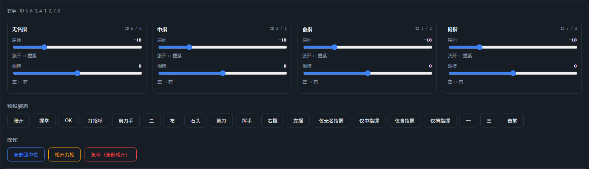
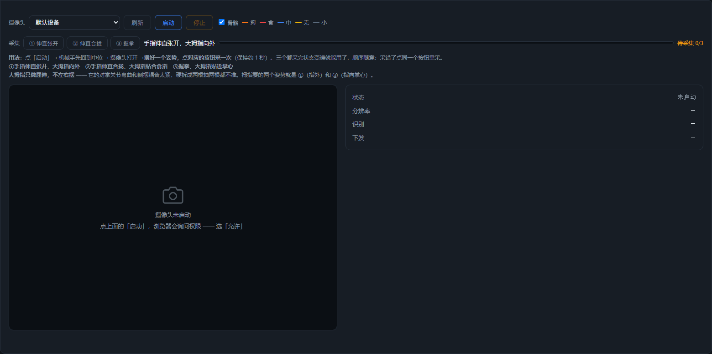

# AmazingHand 網頁控制

用瀏覽器控制 AmazingHand 靈巧手，**左手 / 右手兩種模式**，兩種操作方式：

- **手動控制** —— 8 個伺服馬達滑桿 + 19 個預設姿態 + 一鍵回中位
- **攝影機互動遙控** —— 瀏覽器本機 MediaPipe 辨識手部動作，即時映射到手指（畫面不出本機）
- **中英文切換** —— 右上角切換，選擇記在瀏覽器裡，下次開啟還是上次那門語言

> 本頁是**通用網頁控制說明**。SCS0009 專用映射/換算見 [SCS0009 網頁控制](scs0009.md)；PWM 專用接線/燒錄/標定見 [PWM 網頁控制](pwm.md)。

## 快速開始

開啟終端機，進入到 Amazinghand-web 目錄下：

```bash
pip install -r requirements.txt

python server.py --no-connect   # 推薦：先起服務，序列埠在網頁裡選（不碰伺服馬達）

# python server.py                # 自動偵測序列埠並連線
# python server.py --port COM9    # 指定序列埠
# python server.py --hand left    # 只啟用左手
# python server.py --driver pwm   # 使用 ESP32-S3 PWM 伺服馬達版本
# python server.py --dry-run      # 完全不開序列埠，只驗證介面
```

瀏覽器開啟 **http://localhost:8000** 。

也可以直接用靜態前端（Web Serial，不需要 Python 伺服端）：

- 線上：<https://juxi-technology.github.io/AmazingHand/Amazinghand-web-io/>（Chrome / Edge）
- 本機：在儲存庫根目錄執行 `python -m http.server 8099`，開啟 <http://localhost:8099/Amazinghand-web-io/>

### 在網頁裡選序列埠

頁面頂端有一排工具列，先選驅動，再選序列埠：

```
驅動  [SCS0009 匯流排 ▾]  序列埠  [COM3 ★ USB-Enhanced-SERIAL CH343 ▾]  [重新整理]  [連線]  [中斷連線]  已連線 COM3
```

- 驅動下拉：**SCS0009 匯流排**（官方匯流排伺服馬達，預設）或 **PWM（ESP32-S3）**（見 [PWM 網頁控制](pwm.md)）
- 下拉框列出本機所有序列埠，常見 USB 轉序列埠晶片（CH34x / CP210x / FTDI 等）標 **★** 並排在最前
- 點 **重新整理** 重新掃描（插拔板子後使用）
- 點 **連線** 連線選中的序列埠；連上後會自動回中位
- 點 **中斷連線** 先鬆開力矩再中斷連線，伺服馬達不會僵在原位（PWM 版沒有力矩命令，見下文說明）
- 換序列埠直接選新的點「連線」即可，舊埠會自動關掉

> **靜態部署（GitHub Pages）沒有 Python 伺服端**：瀏覽器出於隱私不能靜默列舉序列埠，只能看到你授權過的裝置。此時點 **新增序列埠…**，在瀏覽器彈窗裡選擇控制板；上面「列出本機所有序列埠」的行為僅適用於 `server.py` 伺服端模式。


> **`--no-connect` 是配合這個流程用的**：啟動時只起服務、完全不碰序列埠，
> 所以不會因為自動連錯埠而讓手亂動。想讓它啟動就自動連，去掉這個參數。

序列埠日誌寫在 `server.log`（雙擊 .bat 啟動時視窗一閃而過，看這個檔案）。

### 接線檢查

列出掃到的伺服馬達 ID，並和 `config.json` 逐隻手核對。

```bash
python tools/scan_servos.py --port COM9
```

COM9 改為自己實際的埠號

> 這個工具只適用於 **SCS0009 匯流排伺服馬達**。PWM 版本的接線檢查見 [PWM 網頁控制](pwm.md)，或用 `AmazingHand-PWM/tools/serial_test.py`。

---

## 預設姿態（19 個）



| 姿態 | 說明 | 姿態 | 說明 |
|---|---|---|---|
| `open` | 張開 | `wave1` | 揮手 |
| `close` / `stone` | 握拳 | `wave_r` / `wave_l` | 左右擺 |
| `ok` | OK | `ring_close` | 僅無名指握 |
| `greeting` | 打招呼 | `middle_close` | 僅中指握 |
| `victory` / `two` / `scissors` | 剪刀手 / 二 | `pointer_close` | 僅食指握 |
| `paper` | 布 | `thumb_close` | 僅拇指握 |
| `one` / `three` | 一 / 三 | `hifive` | 擊掌 |

要自行修改姿態的話，編輯 `config.json` 的 `poses` 段；鍵名對應官方 YAML 裡的名字。

### 左右手可以是不同的姿態值

每條姿態裡的 `positions` 是**左右手共用**的。如果哪隻手因為機械裝配差異需要另一套值，
在同一條裡加一個 `right` 或 `left` 鍵即可，它會覆蓋 `positions`：

```jsonc
"close": {
  "label": "握拳",
  "positions": [75, 75, 75, 75, 75, 75, 18, 18],   // 兩隻手共用
  "right":     [ ... 8 個值 ... ]                   // 可選：只給右手用
}
```

---

## 兩種模式

| 模式 | 行為 |
|---|---|
| **右手** | 只下發右手 8 個伺服馬達 |
| **左手** | 只下發左手 8 個伺服馬達（SCS0009 自動套用鏡像和 −35.16° 偏移；PWM 使用左手通道映射）|

一次只控制一隻手，用頂部「控制對象」切換；切換不影響另一隻手，它保持目前姿態停在原地。SCS0009 雙手可以接在同一條匯流排上；PWM 每隻手各由一塊 ESP32-S3 控制。

---

## 攝影機互動遙控

瀏覽器本機跑 MediaPipe 手部關鍵點（資源在 `Amazinghand-web/web/mediapipe/`，離線可用；頁面也會優先探測 `Amazinghand-web-io/mediapipe/`），
把 21 個關鍵點換算成 4 根手指的姿態值，即時下發給目前選中的手。



### 一、先採三個姿勢

啟動攝影機後，擺好一個姿勢、點對應的按鈕採一次（約 1 秒取平均）。
順序隨意，採錯了點同一個按鈕重採。**三個都採完狀態才會變綠**；
採完之前不下發，機械手保持在中位姿態不動。

| 按鈕 | 姿勢 | 給出什麼 |
|---|---|---|
| ① 伸直張開 | 手指伸直張開，拇指向外 | 屈伸的「伸直」端 + 側擺的「張開」端 |
| ② 伸直合攏 | 手指伸直合攏，拇指貼合食指 | 側擺的「合攏」端 |
| ③ 握拳 | 握拳，拇指貼近掌心 | 屈伸的「握拳」端 |

### 二、兩根軸各自兩點實測

屈伸和側擺都用**兩個實測端點定一條直線**：

```
t    = (量測值 − 端點A) / (端點B − 端點A)        // 鉗制在 0~1
目標 = A的目標值 + (B的目標值 − A的目標值) × t
```

好處是**各手指量測值的正負方向被自動吸收** —— 所以不需要「某根手指要勾反向」
這類開關（食指和無名指分處中軸兩側、拇指關節鏈又不同，方向本來就是反的，
但兩個實測端點一夾就自動對上了）。

端點目標值在 `config.json` 的 `camera` 段：

| 軸 | 端點 | 無名指 | 中指 | 食指 |
|---|---|---|---|---|
| 屈伸 | 伸直 → 握拳 | −50 → 90 | −50 → 90 | −50 → 90 |
| 側擺 | 合攏 → 張開 | −45 → +45 | 0 → 0 | +45 → −45 |

中指側擺兩端都是 0（它不左右擺）。

### 三、拇指只做屈伸 ⚠️

拇指的 CMC 是**對掌關節**，彎曲和左右擺耦合得很緊 —— 拇指貼著食指時它已經在
側擺位上了，那一刻量到的「屈伸零點」是被污染的。硬拆成兩根軸，結果是兩根都不準。

所以拇指**只做屈伸、側擺恆為 0**（兩個伺服馬達的側擺差動量為 0）。它要的兩個參考姿勢就是
①（指外）和 ③（指向掌心），不用額外採。

### 四、側擺會隨彎曲衰減

最終側擺按下式收放：

```
side = side_measured × (1 − curl)
```

`splayDeg` 取的是 MCP→PIP 方向在掌面橫軸上的投影，而手指彎曲**正是繞這根軸轉的** ——
彎到一定程度這個投影會翻向，「張開度」突然甩到另一頭。

不衰減的話，這個突跳會順著 `servo2 = 屈伸 − 側擺` 把**偶數 ID 伺服馬達**帶著反向掉頭
（奇數 ID 拿到的是 `屈伸 + 側擺`，變化方向相反，所以不那麼明顯）。
現象就是「握拳握到一半，12 和 16 號伺服馬達猛地反轉」—— 12 是左手無名指的第二個伺服馬達、
16 是左手食指的第二個伺服馬達，正好是側擺分量非零時被差動帶走的那兩根。

加上衰減後，握緊時側擺**恆為 0**，跟量測值多離譜無關。而且握拳本來就該是併攏的。

### 五、骨骼配色

| 手指 | 顏色 |
|---|---|
| 拇指 | 橙 |
| 食指 | 紅 |
| 中指 | 藍 |
| 無名指 | 黃 |
| 小指 | 暗灰 |
| 掌骨 | 中性灰 |

小指不參與手勢映射，但它的**根部 MCP（17 號點）用來定右手的手掌座標系**，所以不能刪。

### 調參速查

| 想改什麼 | 改哪裡 |
|---|---|
| 各軸目標值 | `config.json` 的 `camera` 段 |
| **左右手側擺方向相反** | `camera.side_sign` 裡那隻手改成 `-1`（`1` = 原樣）|
| 平滑程度 | `tracking.js` 的 `SMOOTH`（預設 0.35；越小越穩但越遲鈍） |
| 手指彎曲的判定快慢 | 重新採一次三個姿勢 |

`side_sign` 是按**「控制對象」選的那隻手**生效的，改完重新整理頁面即可，不用重啟服務：

```jsonc
"side_sign": { "right": 1, "left": -1 }   // 左手把整根側擺軸取反
```

屈伸（flexion）不受 `side_sign` 影響。

---

## 專案結構

```
Amazinghand-web-io/          前端（靜態，可單獨部署）
├── index.html
├── app.js                   介面、驅動切換、姿態與攝影機 UI
├── io.js                    SCS0009 Web Serial 後端
├── pwm.js                   PWM Web Serial 後端
├── common.js                共用設定、姿態換算與限位
├── ws.js                    WebSocket 後端（Python 伺服端模式）
├── tracking.js              MediaPipe 攝影機追蹤
├── i18n.js                  中英文文案
├── config.json              驅動、伺服馬達映射、姿態庫、攝影機參數
└── tools/pwm_protocol_test.mjs

Amazinghand-web/
├── server.py                HTTP + WebSocket + 序列埠伺服端
├── requirements.txt
├── tools/scan_servos.py     掃描 SCS0009 匯流排並核對 ID
└── web/mediapipe/           MediaPipe 資源（離線，約 42MB）
```

前後端協定：

```jsonc
// 前端 → 後端   target: "left" | "right"
{ "cmd": "ports" }                                  // 重新掃描序列埠
{ "cmd": "driver", "driver": "pwm" }                // scs0009 | pwm
{ "cmd": "connect",    "port": "COM3" }
{ "cmd": "disconnect" }
{ "cmd": "target", "target": "left" }
{ "cmd": "set",    "target": "left", "angles": { "pointer": [0, 0], ... } }
{ "cmd": "pose",   "target": "left", "name": "close" }
{ "cmd": "middle", "target": "left" }
{ "cmd": "torque", "target": "left", "on": true }   // 僅 SCS0009
{ "cmd": "stop" }

// 後端 → 前端
{ "type": "state", "hands": {...}, "poses": {...}, "positions": {...},
  "axes": {...}, "camera": {...}, "target": "left", "driver": "scs0009",
  "capabilities": { "torque": true, "speed": true }, "pwm": {...},
  "limits": {...}, "port": { "available": [...], "current": "COM3", "connected": true } }
{ "type": "ports" | "connected" | "disconnected", "ports": [...], ... }
{ "type": "error", "msg": "连接 COM_FAKE 失败：系统找不到指定的文件。" }
```

---

## 安全設計

| 項目 | 說明 |
|---|---|
| **姿態限位** | 姿態值 ±120°（`config.json` 的 `limits`），所有 19 個姿態已核對不超限 |
| **變化去重** | 變化 < 0.5° 不下發，避免匯流排被雜訊佔滿 |
| **寫入限流** | SCS0009 最小間隔 20ms；PWM 直驅約 30ms |
| **急停** | SCS0009：鬆開全部力矩；PWM：發送 `0xFF` 中止手勢，伺服馬達仍通電保持位置 |
| **退出保護** | SCS0009：Ctrl+C 關閉力矩；PWM：中斷序列埠後伺服馬達保持位置 |
| **單手除錯** | `--hand left/right` |

---

## 常見問題

**攝影機辨識不準** → 光線均勻、手掌正對鏡頭。`tracking.js` 裡 `SMOOTH`（預設 0.35）越大越平滑但越遲鈍。

**攝影機手勢不對、某根手指不跟手** → 先確認三個姿勢都採完（狀態變綠）；方向反了就重採對應姿勢；拇指只做屈伸，不參與側擺。

**握拳握到一半某伺服馬達猛地反轉** → 檢查側擺是否隨彎曲衰減到 0（`side *= (1 - curl)`），以及側擺控制量的符號/大小是否異常。

**SCS0009 方向/ID/中位問題** → 見 [SCS0009 網頁控制](scs0009.md) 和 [SCS0009 調校與標定](../06-servo-tuning/scs0009.md)。

**PWM 連線/鮑率/標定問題** → 見 [PWM 網頁控制](pwm.md)。

**更多問題** → [FAQ](../08-faq/faq.md)。
